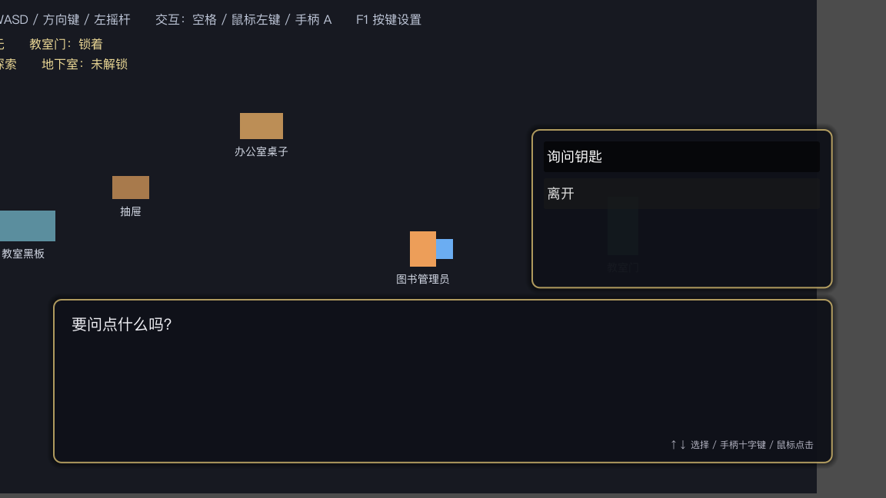
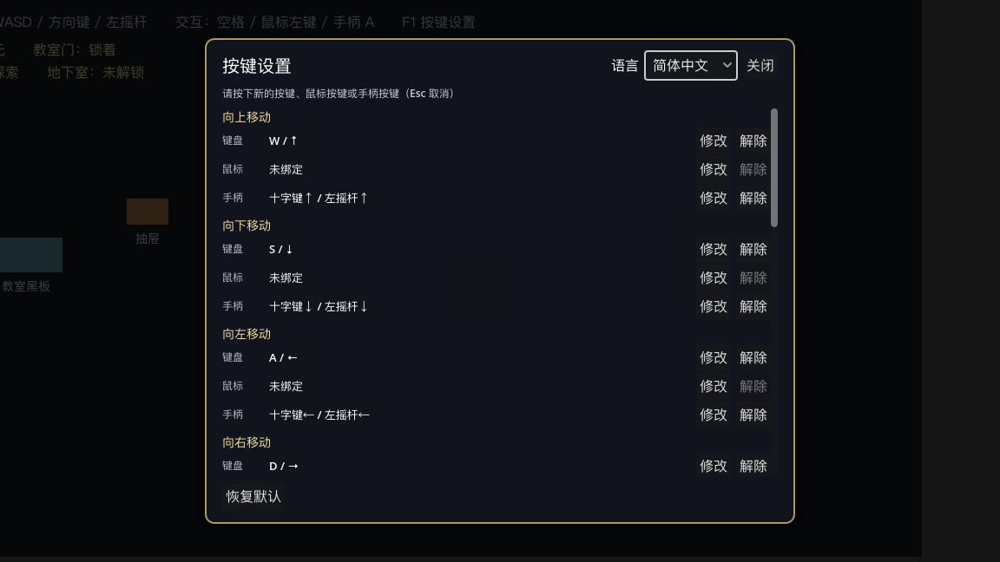
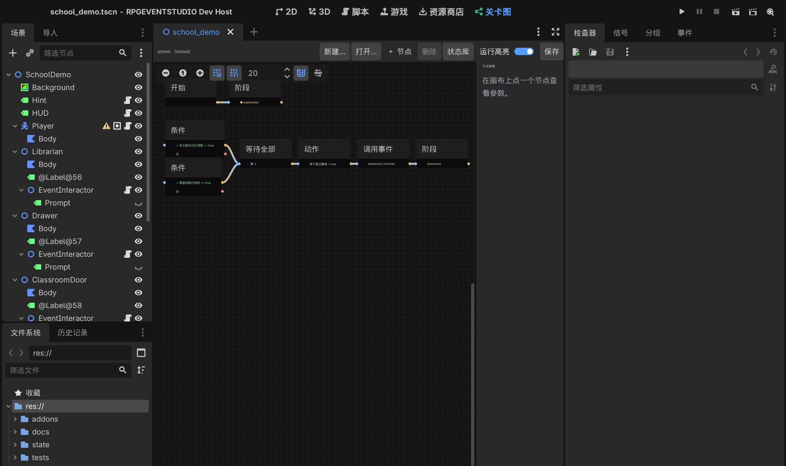

> **0.2.0-rc2 发布候选**：安装、第三方接入、状态事务升级规则和依赖以 [安装说明](docs/release/INSTALL.md) 为准；[发布说明草案](docs/release/RELEASE_NOTES.md)。完整验证使用 `python3 tools/test_runner.py --all`（自动首次导入）。

# Godot RPG Event Studio（RPGEVENTSTUDIO）

在 Godot 4 里给 NPC、门、抽屉、机关配事件，**不写 GDScript**。
像 RPG Maker 那样一页一页配条件、一条一条加指令，游戏里直接跑起来。

---

## 作者与许可

**elawang49-ui** · **elawang49@gmail.com**

**源码公开，允许用于商业游戏，禁止售卖插件本体及修改版。** 允许收费游戏、广告、内购和付费游戏内容；随游戏打包插件运行时不算售卖插件。查看、修改和免费分享插件时请保留许可证。具体边界见 [许可说明](LICENSING.md) 和 [完整许可证](LICENSE)。这是自定义源码许可，不是MIT/GPL或OSI认可的开源许可证。

## 现在能做什么

| 功能 | 状态 | 说明 |
| --- | --- | --- |
| 事件多页 | ✅ | 条件不同显示不同内容；页序号越大优先级越高 |
| 出现条件 | ✅ | 开关 / 变量 等于、不等于、大于小于 |
| 玩家交互触发 | ✅ | 走近显示「▲ 交互」，按键或鼠标点击触发 |
| 区域 / 自动 / 并行事件 | ✅ | 有防重复触发保护 |
| 显示文字 / 选项 | ✅ | 打字机效果，选项可用键盘、手柄、鼠标 |
| **自定义展示层** | ✅ | `StudioRuntime.set_presenter()` 可换成游戏自己的叙事 UI，事件资源不变；见 [18-展示层注入](docs/18-展示层注入.md) |
| **BBCode 富文本** | ✅ | `[b]` / `[i]` / `[color]` / `[font_size]` / `[center]` 等可直接写；编辑器实时预览，游戏内按可见文字打字；见 [19-BBCode富文本](docs/19-BBCode富文本.md) |
| **条件分歧（多层嵌套）** | ✅ | 列表里直接看到「是 / 否」分支，可在分支里增删改、再嵌套条件分歧 |
| 开关 / 变量 / 变量运算 | ✅ | 名字随便起，如 `Global.Player.HasKey` |
| 等待 / 音效 / 公共事件 / 结束事件 | ✅ | |
| **按键自定义（键鼠 + 手柄）** | ✅ | 游戏内按 **F1** 打开，键盘 / 鼠标 / 手柄分开显示与修改 |
| **简体中文 / English** | ✅ | 编辑器界面与游戏界面各有独立语言开关 |
| 撤销 / 重做 | ✅ | 覆盖增删、排序、跨分支移动、参数修改 |
| **关卡总控图** | ✅ | 编辑器主屏「关卡图」：阶段、条件、动作、调用事件、AND/OR 汇合、关卡完成 |
| **状态驱动推进** | ✅ | 条件可持续监视状态，两处调查都完成后自动解锁地下室，不用写脚本 |
| **状态库（显示名）** | ✅ | 每个状态有内部标识 + 你起的中文名；条件/开关/变量/图节点都从下拉里选，不用背标识 |
| **状态库批量登记** | ✅ | 「批量登记…」扫描全工程的未登记状态，按类型推断批量入库，写入失败自动回滚 |
| **新建事件 / 新建关卡图** | ✅ | 面板里一键新建并自动挂到选中节点；新图自带「开始」节点 |
| **F2 状态调试** | ✅ | 游戏内查看所有状态、未登记状态、以及「事件为什么没执行」的逐条件说明 |
| **F2 运行追踪（Runtime Trace）** | ✅ | 记录事件→页面→指令→条件→状态→关卡图的完整执行过程；自然语言时间线，可按事件/状态/结果过滤，双击定位，可导出 JSON；见 [26-Runtime Trace 使用教程](docs/26-Runtime%20Trace%20使用教程.md) |
| **事件列表** | ✅ | 右侧停靠面板列出全部事件与关卡图，可搜索、双击直接打开 |
| **剧情工作台** | ✅ | 主屏「剧情」页：台词/选项/条件/开关逐行编辑，角色花名册、BBCode 预览、撤销重做 |
| **关卡图运行高亮** | ✅ | 从编辑器启动游戏时，图上的节点会显示 ▶ 执行中 / ✓ 已完成 / ● 当前阶段 |
| **交互目标提示** | ✅ | 多个对象重叠时只显示最近那个的「名字 + 按键」，带光圈；平手按固定规则，不会来回跳 |
| **地图事件放置** | ✅ | 2D 场景里放置 MapEvent2D：NPC / 调查点 / 宝箱 / 门 / 机关 / 触发区；Inspector 关联事件、层级与触发范围，主屏「地图事件」页总览；见 [20-地图事件放置](docs/20-地图事件放置.md) |
| **UI 主题定制** | ✅ | 主屏「UI 主题」页：对话框/文字/选项/动画/交互提示实时预览、保存/重载/恢复默认；游戏原生 UI 项目显示只读能力边界；见 [21-UI主题定制](docs/21-UI主题定制.md) |
| **状态存档桥** | ✅ | StateStore 快照可写入游戏存档与章节快照，不合并两套状态系统；见 [22-状态持久化边界](docs/22-状态持久化边界.md) |
| **演出指令** | ✅ | 移动角色 / 镜头聚焦与恢复 / 淡入淡出 / 音效（可等待），全部可保存、撤销、被中断后收尾 |
| **场景对象选择器** | ✅ | 移动/镜头的目标从当前场景里点选，显示名字+路径，失效有红字提示；引用规则见 docs/16 |
| **事件模板** | ✅ | 剧情页「从模板新建」：NPC 对话/调查/多选项/条件分支/物品获取/门锁/自动触发 7 种（自定义模板管理未做） |
| **剧情资源审计** | ✅ | 主屏「审计」页：空事件、重复 ID、断裂引用、缺失公共事件/音频、未登记状态、图错误，双击定位 |
| 调试状态显示 | ✅ | 演示场景实时显示开关状态 |
| 通用存档 / AI / 时间轴 | ⬜ | 后续阶段 |

> **第一次用？先看 [从零做一段剧情教程](docs/14-上手教程-从零做一段剧情.md)** —— 按编辑器真实按钮写的，20 分钟做出「两条线索解锁地下室」。

**验收标准（需求文档原文）已达成**：和 NPC 交互，第一次拿到钥匙，第二次台词不同，NPC 上没有任何自定义脚本。

---

## 30 秒跑起来

1. 打开 Godot **4.7**，项目管理器 → 导入 → 选 `RPGEVENTSTUDIO/project.godot`。
2. 按 **F5**（主场景已设为演示关卡 `school_demo.tscn`）。
3. 操作：
   - **WASD / 方向键 / 手柄左摇杆** 移动
   - 走到「图书管理员」旁边，**空格 / 回车 / 鼠标左键 / 手柄 A** 交互
   - 选「询问钥匙」→ 拿到钥匙 → 去右边开教室门 → 再回来找管理员，台词变了
   - 再调查左上方的**办公室桌子**和右下方的**教室黑板**，两处都完成后**地下室会自动解锁**（阶段切到「地下室」）
   - 按 **F1** 打开按键设置，可以改成任何键盘键、鼠标键或手柄键
   - 在 F1 面板右上角可以把**游戏语言**切成 English

左上角实时显示「钥匙：已获得 / 教室门：已打开」，切语言时会一起变。





---

## 自己做一个事件（3 步）

1. **挂组件**：选中 NPC 节点 → 添加子节点 → 搜 `EventInteractor2D`。
   （区域触发用 `EventTriggerArea2D`，自动剧情用 `EventAutoRun2D`。）
2. **指定事件文件**：组件属性里 `event_path` 指向一个 `.tres`。
   新建：文件系统右键 → 新建资源 → 搜 `EventDefinition` → 存成 `res://events/xxx.tres`。
3. **配内容**：选中组件节点 → 右侧「事件」面板 → 加页、加条件、加指令、点「保存」。

不用写一行代码。

---

## 编辑器面板长什么样

```
事件
图书管理员  [librarian]          语言[中文▾]  [保存]
[1] [2] [＋] [－]
触发 [玩家交互 ▾]   重复 [每次都执行 ▾]
出现条件（全部满足才生效）
  [Global.Player.HasKey] [== ▾] [true]      [×]
  ＋ 添加条件
────────────────────────────────
＋ 指令  [删除] [↑] [↓]
[剪切] [粘贴] [→ 另一分支] [移出分支]
◆ 显示文字：你看起来在找什么？
◆ 显示选项：要问点什么吗？
◆ 条件分歧：@@self.choice == 0
   ├ 是：                              [＋]
      ◆ 显示文字：这把钥匙给你，别弄丢了。
      ◆ 设置开关：Global.Player.HasKey = ON
   ├ 否：                              [＋]
      ◆ 显示文字：那就随便看看吧。
◆ 结束事件
────────────────────────────────
将插入到：第 1 页 › 条件分歧 #3 › 「是」分支
选中指令的参数
  说话人 [图书管理员        ]
  内容   [你看起来在找什么？ ]
```

要点：

- 分支标题右侧的 **＋** 把新指令加到**那个分支**里；选中分支内某条指令再点顶部「＋ 指令」，会插在它后面（同一条分支）。
- 底部蓝色提示永远告诉你"下一条会插到哪"。
- 「→ 另一分支」把选中的指令挪到同一分歧的另一边；「剪切 / 粘贴」可以搬到任意位置。
- 条件分歧里还能再放条件分歧，层数不限。

---

## 演出指令（第三阶段）

事件编辑器里现在多了「角色与镜头」分类：

| 指令 | 参数 |
| --- | --- |
| 移动角色 | 角色（节点路径）、横/纵偏移、时长、是否等待 |
| 镜头聚焦 | 目标（留空=玩家）、偏移、时长、是否等待 |
| 镜头恢复 | 时长、是否等待 |
| 淡入淡出 | 方向（淡出到黑 / 从黑淡入）、时长、是否等待 |
| 播放音效 | 音频、音量、是否等待播完 |

演示关卡里「解锁地下室」之后会自动播放一段过场：淡出 → 台词 → 淡入 → 镜头拉到管理员 → 管理员走近 → 音效 → 台词 → 镜头恢复。
被中断（切场景、取消）时，tween 会停、画面会恢复正常，不会卡黑屏。

## 关卡图怎么用（第二阶段）

编辑器顶部会多一个主屏 **「关卡图」**（和 2D / 3D / 脚本 并列）。

- `打开…` 选一个 `LevelGraph` 的 `.tres`（演示图在 `samples/graphs/school_graph.tres`）。
- `＋ 节点` 里有：开始 / 阶段 / 条件 / 动作 / 调用事件 / 等待全部（AND）/ 等待任一（OR）/ 关卡完成。
- 从节点右侧圆点拖到另一个节点左侧即可连线；点节点在右侧改参数。
- 加节点、删节点、连线、断线、改参数都能 `Ctrl+Z` 撤回；`保存` 写回资源。

演示图长这样：

```
                      ┌── 条件：School.Office.DiaryFound == true ──┐
开始 ──► 阶段：探索 ──┤                                            ├──► 等待全部(2) ──► 解锁地下室 ──► 提示 ──► 阶段：地下室
                      └── 条件：School.Classroom.ClueFound == true ┘
```



要点：**条件是「监视」的**。事件只负责把状态写成 true，图自己发现条件成立就往下走——
不依赖事件发通知，所以读档、重进关卡、中途启用图都不会漏推进。

---

## 按键设置（游戏内 F1）

```
按键设置                       语言 [简体中文▾]  [关闭]
交互
  键盘  空格 / 回车                 [修改] [解除]
  鼠标  鼠标左键                    [修改] [解除]
  手柄  手柄 A                      [修改] [解除]
对话推进
  键盘  空格 / 回车                 [修改] [解除]
  鼠标  鼠标左键                    [修改] [解除]
  手柄  手柄 A                      [修改] [解除]
...
[恢复默认]
```

- 点「修改」→ 按下新键即可；**Esc 取消**。
- 如果这个输入已经被别的动用了，会提示「已经被 xxx 使用」，可以选「仍然绑定」或「取消」。
- 修改立即保存到 `user://rpg_event_studio/input_map.cfg`，重启游戏仍然有效。
- 键盘绑定按**物理按键位置**记录，换键盘布局不会错位。

---

## 语言

| 范围 | 在哪切换 | 存在哪 |
| --- | --- | --- |
| 编辑器界面 | 事件面板右上角 | Godot 编辑器设置（不写进项目） |
| 游戏界面 | 游戏内 F1 面板 | `user://rpg_event_studio/settings.cfg` |

两者互不影响。翻译词条在 `addons/rpgeventstudio/i18n/ui.csv`，中英各一列；新增词条的方法见 [docs/12](docs/12-嵌套编辑-输入-本地化.md)。

**NPC 台词、变量名、开关名不会被翻译**——它们是创作数据。

---

## 目录

```
RPGEVENTSTUDIO/
├── project.godot                       开发用工程（打开即启用插件 + 自动加载运行时）
├── addons/rpgeventstudio/              插件本体（拷到别的项目直接用）
│   ├── plugin.gd                       编辑器入口：面板、Autoload、编辑器语言
│   ├── core/                           数据与运行时（不碰 UI）
│   │   ├── model/                      事件、事件页、指令、条件
│   │   ├── state/                      全局/关卡/局部状态
│   │   ├── audit/                      剧情资源审计（扫描 + 问题模型）
│   │   ├── trace/                      运行时追踪数据模型（环形缓冲）
│   │   ├── runtime/                    事件执行器 + 14 条指令 + 指令注册表
│   │   ├── graph/                      关卡图执行器（令牌流 / 监视 / 汇合）
│   │   ├── input/                      统一输入服务（动作表、改键、持久化）
│   │   ├── i18n/                       本地化入口 L10n
│   │   ├── state/                      状态定义、状态库（显示名 ↔ 内部标识）
│   │   └── util/
│   ├── i18n/ui.csv                     翻译源文件（zh_CN / en）
│   ├── editor/event_editor/            右侧事件编辑面板（含树形分支）
│   ├── editor/level_graph/             关卡图编辑器（编辑器主屏）
│   ├── editor/pickers/                 状态选择器、状态库对话框
│   ├── editor/event_list/              事件与关卡图列表
│   ├── editor/story/                   剧情工作台（主屏）
│   ├── editor/audit/                   剧情资源审计面板（主屏）
│   ├── editor/debugger/                运行高亮与追踪定位的调试器通道
│   ├── runtime/autoload/               游戏运行时单例 RPGEventStudio
│   ├── runtime/ui/                     对话框、按键设置、F2 状态与运行追踪
│   ├── runtime/components/             交互 / 区域 / 自动事件 组件
│   └── samples/                        演示关卡、示例事件、示例角色
├── docs/                               设计文档 + 教程 + 可用性报告
├── state/state_catalog.tres            状态库（演示用）
└── tools/                              示例数据生成、校验脚本
```

装到自己的项目：把 `addons/rpgeventstudio/` 整个复制过去，在「项目设置 → 插件」里启用即可（Autoload 会自动加）。
卸载：禁用插件 → 删除 `addons/rpgeventstudio/`。

---

## 测试

统一入口（推荐）：

```bash
python3 tools/test_runner.py --all        # headless + 编辑器 + 故障注入
python3 tools/test_runner.py --faults     # 证明异常/中断/缺汇总不会假绿
```

headless 套件（22 个，合计 1287 项检查）：

```bash
python3 tools/test_runner.py --headless
```

编辑器自测（6 个，合计 228 项检查）：

```bash
python3 tools/test_runner.py --editor
```

直接跑单个脚本仍可用，例如 `Godot --headless --path . --script res://tests/run.gd`（355 项）。
测试运行器会校验：最终汇总、SCRIPT ERROR/ERROR、CASE 完成标记、检查数与
`tools/test_counts.json` 快照一致。不同套件之间存在重复覆盖，检查项总数不等于独立用例数。

重新生成示例事件与演示场景：

```bash
Godot --headless --path . --script res://tools/build_samples.gd
```

---

## 已知限制（老实说）

1. 事件里的条件分歧还没有 AND/OR 组合面板（多条条件靠嵌套表达）；关卡图里的 AND/OR 已经可用。
2. 改键界面的「解除」是按设备整组清理，不能只删掉其中一个键。
3. 多手柄同时连接时所有手柄都会生效（未做玩家编号绑定）；手柄测试为事件模拟，未接真实手柄硬件。
4. 事件模板只有内置 7 种，暂不支持用户自定义模板管理。
5. 通用存档（检查点/章节）只有快照桥接口；AI 生成、时间轴未做——按路线图在后面阶段。
6. Runtime Trace 只记录内存中的本次运行：默认容量 2000，超出丢弃旧记录；不支持回放；
   等待超时没有独立结果；「调用另一个事件」目前只有公共事件（内联执行）。

---

## 设计文档

| 内容 | 文件 |
| --- | --- |
| **上手教程（先看这个）** | [14-上手教程-从零做一段剧情](docs/14-上手教程-从零做一段剧情.md) |
| **可用性检查报告** | [15-可用性检查报告](docs/15-可用性检查报告.md) |
| 关卡总控图实现 | [13-关卡总控图实现](docs/13-关卡总控图实现.md) |
| 上一轮交付：嵌套编辑 / 输入 / 本地化 | [12-嵌套编辑-输入-本地化](docs/12-嵌套编辑-输入-本地化.md) |
| 可行性、架构冲突与取舍 | [01-可行性评估与架构冲突](docs/01-可行性评估与架构冲突.md) |
| 模块划分与数据模型 | [02-系统模块与数据架构](docs/02-系统模块与数据架构.md) |
| 状态管理服务 | [03-统一状态管理服务](docs/03-统一状态管理服务.md) |
| 事件运行时 | [04-事件运行时](docs/04-事件运行时.md) |
| 关卡总控图（设计） | [05-关卡总控图](docs/05-关卡总控图.md) |
| 事件与总控图通信 | [06-局部事件与总控图通信](docs/06-局部事件与总控图通信.md) |
| 目录与依赖红线 | [07-插件目录结构](docs/07-插件目录结构.md) |
| 编辑器界面布局 | [08-编辑器界面布局](docs/08-编辑器界面布局.md) |
| 第一阶段计划与实现情况 | [09-第一阶段原型计划](docs/09-第一阶段原型计划.md) |
| 优先级与路线图 | [10-功能优先级与路线图](docs/10-功能优先级与路线图.md) |
| 技术决策记录 | [11-待确认技术决策](docs/11-待确认技术决策.md) |
| 展示层注入 | [18-展示层注入](docs/18-展示层注入.md) |
| BBCode 富文本 | [19-BBCode富文本](docs/19-BBCode富文本.md) |
| 地图事件放置 | [20-地图事件放置](docs/20-地图事件放置.md) |
| UI 主题定制 | [21-UI主题定制](docs/21-UI主题定制.md) |
| 状态持久化边界 | [22-状态持久化边界](docs/22-状态持久化边界.md) |
| 运行时剧情追踪 | [25-运行时剧情追踪](docs/25-运行时剧情追踪.md) |
| **Runtime Trace 使用教程（创作者）** | [26-Runtime Trace 使用教程](docs/26-Runtime%20Trace%20使用教程.md) |
