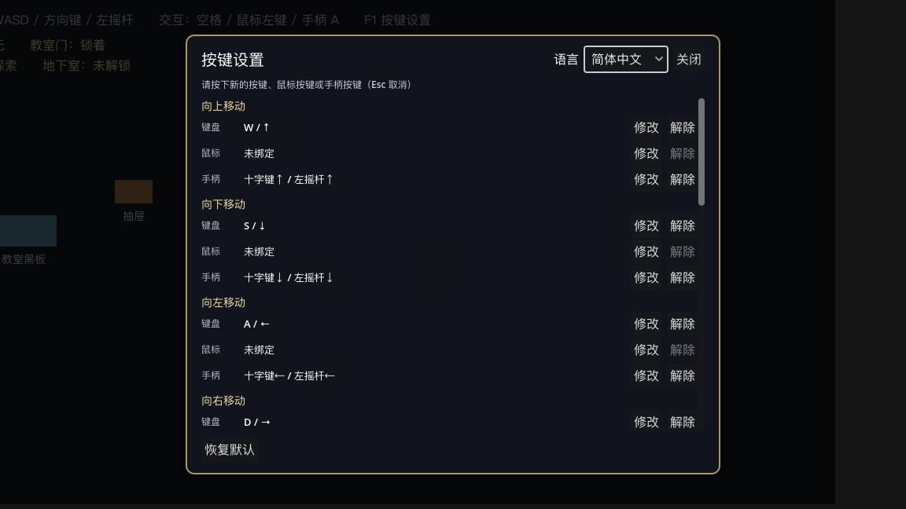

# 12 · 嵌套编辑、输入映射与本地化（第二轮交付说明）

> 本文件记录第二阶段追加的三块能力：条件分歧的树形编辑、统一输入映射与改键、简体中文 / 英语本地化。
> 与第一阶段的设计文档冲突时，以本文件为准。

---

## 一、条件分歧的树形编辑

### 1.1 数据模型没有变

`EventCommand` 仍然是：

```
EventCommand
├─ type: StringName          # show_text / if / ...
├─ params: Dictionary
├─ children: Array[EventCommand]        # 「是」分支 / 循环体
└─ else_children: Array[EventCommand]   # 「否」分支
```

**没有引入新的节点类型，也没有迁移旧资源**。第一阶段保存的 `.tres` 直接继续可用（`tests/run.gd` 里有旧资源读取用例）。

之所以能不改结构就支持多层嵌套，是因为嵌套关系从一开始就存在数组里，而不是靠缩进推断——第一阶段的编辑器只是没有把「往哪个数组里插」这件事暴露出来。

### 1.2 列表长什么样

```
◆ 显示文字：你看起来在找什么？          ← 普通指令
◆ 条件分歧：@@self.choice == 0
   ├ 是：                                              ← 分支标题
      ◆ 显示文字：这把钥匙给你，别弄丢了。
      ◆ 设置开关：Global.Player.HasKey = ON
      ＋                                                ← 分支标题右侧的 ＋
   ├ 否：
      ◆ 显示文字：那就随便看看吧。
      ＋
◆ 结束事件
```

- 缩进、`├ 是：` / `├ 否：`、`（空）` 占位，都是为了让人一眼看出层级。
- 每个分支标题右侧有一个 `＋`，点它会把新指令加到**该分支末尾**，并弹出指令菜单。
- 空分支显示「（空）」，但 `＋` 依然可用。

### 1.3 插入目标永远有明确提示

编辑器底部有一行蓝色提示：

```
将插入到：第 1 页 › 条件分歧 #2 › 「是」分支
```

它由三种操作更新：

| 操作 | 插入位置 |
| --- | --- |
| 点某条指令 | 该指令**后面**，同一层 |
| 点分支的 `＋` | 该分支**末尾** |
| 什么都没选 | 当前事件页**末尾** |

这样就不会出现"以为插在分支里、结果加到了页末尾"的情况。

### 1.4 移动指令

| 按钮 | 作用 | 边界 |
| --- | --- | --- |
| `↑` / `↓` | 在同一条分支内换位置 | 到顶/到底禁用 |
| `→ 另一分支` | 移到所属条件分歧的另一条分支（追加到末尾） | 只在分支内可用 |
| `移出分支` | 移回上层，放在所属条件分歧后面 | 只在分支内可用 |
| `剪切` / `粘贴` | 跨任意位置搬运；粘贴到当前插入目标 | 剪贴板为空时禁用 |

`剪切` 会先复制一份到剪贴板再删除，因此粘贴出来的是独立副本，不会出现同一个对象被两个数组引用的情况。

### 1.5 撤销 / 重做

全部走 `EditorUndoRedoManager`，`custom_context` 是当前的 `EventPage`，所以事件编辑和场景编辑的撤销历史互不干扰。

| 操作 | 撤销后 |
| --- | --- |
| 新增指令（任意层级） | 从所在数组移除 |
| 删除指令 | 插回原位，**同一个对象**（不是复制品） |
| 上移 / 下移 | 顺序还原 |
| 移到另一分支 / 移出分支 | 从目标数组移除、放回来源数组原位 |
| 修改参数 | 参数还原（连续输入合并成一步） |

参数修改用 `commit_action(false)` 登记（值已由控件写入），`MERGE_ENDS` 按「指令 + 参数名」合并——一次输入不会产生几十条撤销记录。

> 这套行为在真实编辑器里由 `tests/editor_selftest.gd` 验证（见第四节），不是只在无头模式里绕过撤销。

---

## 二、输入映射

### 2.1 审计发现的问题（已修）

第一阶段实际上只做了三件事：

1. Autoload 里用代码硬编码了 `Space / Enter / 手柄 A`；
2. 玩家脚本里同时写了 `ui_*` 动作和 `KEY_A/KEY_D/KEY_W/KEY_S`；
3. 对话框里写死了 `ui_accept`。

所以「看起来只有手柄映射」的原因是：**项目 `project.godot` 里根本没有输入映射表**，全是运行期临时拼出来的，编辑器「项目设置 → 输入映射」里自然是空的。

### 2.2 现在的动作表

所有游戏内操作只认动作名，不认按键。默认值集中在 `core/input/input_service.gd` 的 `ACTIONS` 表里。

| 动作 | 默认键盘 | 默认鼠标 | 默认手柄 |
| --- | --- | --- | --- |
| `move_up` | W、↑ | — | 十字键↑、左摇杆↑ |
| `move_down` | S、↓ | — | 十字键↓、左摇杆↓ |
| `move_left` | A、← | — | 十字键←、左摇杆← |
| `move_right` | D、→ | — | 十字键→、左摇杆→ |
| `interact` | 空格、回车 | 左键（只在对象附近生效） | A |
| `confirm` | 空格、回车 | 左键 | A |
| `cancel` | Esc | 右键 | B |
| `choice_up` | ↑、W | — | 十字键↑ |
| `choice_down` | ↓、S | — | 十字键↓ |
| `toggle_settings` | F1 | — | Back |

说明：

- `interact` 与 `confirm` 默认共用同一组键，这是刻意的：交互与对话推进在游戏里不会同时发生（有事件运行时交互被锁定）。改键时它们各自独立。
- 移动用 `physical_keycode`（按键盘物理位置），AZERTY 等布局下 WASD 不会错位。
- 鼠标左键同时出现在 `interact` 和 `confirm` 上，但触发路径互斥：
  - 世界交互由交互组件判断"点击位置是否在对象附近"（±24px）；
  - 对话推进由对话框判断，且**选项面板打开时忽略鼠标确认**，让按钮自己处理点击。
  所以一次点击只会被一个地方消费。

### 2.3 玩家 / 对话 / 交互分别读哪个动作

| 模块 | 读的动作 |
| --- | --- |
| `samples/player.gd` | `move_up/down/left/right`（`get_vector`） |
| `EventInteractor2D` | `interact` |
| `DialoguePresenter` | `confirm`、`cancel`（关闭）、`choice_up`、`choice_down` |
| `InputSettingsPanel` | `cancel`（关闭面板） |
| `StudioRuntime` | `toggle_settings` |

没有任何脚本再写死 `KEY_*` 或 `ui_accept`（`samples/` 与测试除外）。

### 2.4 改键界面

游戏内按 **F1**（或调用 `RPGEventStudio.open_input_settings()`）打开：

```
按键设置                                    语言 [简体中文▾]  [关闭]
请按下新的按键、鼠标按键或手柄按键（Esc 取消）

向上移动
  键盘  W / ↑                          [修改] [解除]
  鼠标  未绑定                          [修改] [解除]
  手柄  十字键↑ / 左摇杆↑                [修改] [解除]
...
[恢复默认]                                          已保存按键设置
```

流程：

1. 点某一行设备后面的「修改」，进入等待输入状态。
2. 按下键盘按键 / 鼠标按键 / 手柄按键即可完成绑定；**Esc 取消**。
3. 若该输入已被别的动作占用，底部会出现冲突提示：

   ```
   「确认 / 对话推进」已经使用了这个输入。   [仍然绑定] [取消]
   ```

   - 「取消」：不绑定，回到改键状态；
   - 「仍然绑定」：允许两个动作共用同一个输入。
   - 想把某个输入彻底让出来，用对应行的「解除」。
4. 「恢复默认」整体还原默认表。
5. 每次改动立即写盘，重启游戏后继续生效。



改键时有一个 250ms 的输入保护期，避免"点修改按钮的那一下"被当成新绑定；`Escape` 单独处理，保证一定能退出改键状态。

### 2.5 持久化

- 路径：`user://rpg_event_studio/input_map.cfg`（ConfigFile）。
- 结构：`[actions]` 下每个动作一个数组，元素是精简后的输入描述：

  ```
  [actions]
  interact = [{"type":"key","keycode":32,...}, {"type":"mouse","button":1}, ...]
  ```

- 只存必要字段（键码、鼠标键、手柄键号、摇杆轴与方向），不存对象引用。
- 保存文件里缺失的动作会自动回落到默认值——升级插件后不会因为动作表变化而丢掉全部设置。
- **按键偏好不进事件 `.tres`**，事件资源里只有动作名与业务参数。

### 2.6 给游戏脚本用的 API

```gdscript
var studio := get_node("/root/RPGEventStudio")
studio.input.is_action_pressed("interact")
studio.input.is_action_just_pressed("interact")
studio.input.get_vector("move_left", "move_right", "move_up", "move_down")
studio.open_input_settings()
studio.set_game_locale("en")
```

---

## 三、本地化

### 3.1 资源结构

```
addons/rpgeventstudio/i18n/
├── ui.csv                 ← 唯一手工维护的源文件（keys, zh_CN, en）
├── ui.zh_CN.translation   ← Godot 用 CSV 导入器生成的资源
├── ui.en.translation
└── ui.csv.import          ← 导入设置（不要手改）
```

`ui.csv` 第一列固定是 `keys`，后面每个语言一列。Godot 的 CSV 导入器会为每一列生成一个 `Translation` 资源，路径就是上面的 `ui.<locale>.translation`。

**没有第二套翻译系统**：编辑器与运行时读的是同一批 `Translation` 资源，只是各自选择语言的入口不同。

### 3.2 两套语言设置（刻意分开）

| 范围 | 存在哪 | 谁改 | 默认 |
| --- | --- | --- | --- |
| 编辑器界面 | `EditorSettings` → `rpg_event_studio/editor_language` | 事件面板右上角的选择框 | `zh_CN` |
| 游戏运行时 | `user://rpg_event_studio/settings.cfg` → `[i18n] locale` | F1 面板里的语言选择 | `zh_CN` |

两者互不影响：切游戏语言不会改编辑器语言，反之亦然（集成测试里有这条断言）。

### 3.3 键命名规范

```
<模块>.<对象>[.<补充>]
editor.*        事件编辑器界面文案
cmd.*           指令显示名
cat.*           指令分类
param.*         指令参数标签
trigger.*       触发方式
repeat.*        重复策略
input.*         按键设置界面与动作名
key.*           键名（空格 / ↑ / 鼠标左键 / 手柄 A …）
game.*          运行期对话框、提示、HUD
sample.*        演示场景专用文案
diag.*          诊断与错误信息
```

改中文文案只动 `ui.csv` 的第二列，键名不变，英文列不受影响——这是"改一个中文文案不会让别的语言失效"的保证。

### 3.4 新增一条翻译

1. 在 `addons/rpgeventstudio/i18n/ui.csv` 加一行（三列都要填，英文可先写英文）：
   ```csv
   editor.my_feature,我的功能,My Feature
   ```
2. 回到 Godot，等它重新导入（或 `项目 → 重新导入`）。
3. 代码里用：
   ```gdscript
   label.text = L10n.ui("editor.my_feature")            # 编辑器
   hint.text = L10n.game("game.my_hint")                # 运行时
   text = L10n.game("game.kill_count", {"count": 3})    # 带参数
   ```
4. 翻译表里用 `{count}` 占位，`L10n` 会做替换（两种语言的占位符顺序可以不同）。

### 3.5 用户内容不翻译

NPC 台词、选项文字、变量名、开关名、事件标题，全部原样显示，不经过 `L10n`。这些是**创作数据**，强行翻译会破坏事件逻辑（状态键本身是标识符）。

后续如果要做剧情多语言，扩展点是：给 `show_text` 的参数加一个"文本 ID"，由项目自己的翻译表解析——但这是下一阶段的事，本轮不做。

### 3.6 回退与缺键

- 找不到某语言的词条 → 回退到 `zh_CN`。
- 仍然找不到 → 返回键名本身（不会显示空白）。
- `L10n` 会记录所有缺失的键，测试里断言"缺键列表为空"；`ui_smoke` 会在中英文两种模式下各渲染一遍编辑器界面来触发这个检查。

### 3.7 运行时还注册了原生翻译

Autoload 启动时会把两个 `Translation` 加进 `TranslationServer` 并把 locale 设为玩家选择的语言。这样项目自己的代码也能直接用 `tr()`，不需要再引插件 API。

---

## 四、测试

| 命令 | 覆盖 | 检查项 |
| --- | --- | --- |
| `godot --headless --path . --script res://tests/run.gd` | 状态、翻页、输入服务、改键面板、本地化、嵌套保存/读取、事件流程、取消 | 71 |
| `godot --headless --path . --script res://tests/ui_smoke.gd` | 面板：增删指令、分支内新增、跨分支移动、剪切粘贴、嵌套分歧、保存重读、中英切换 | 40 |
| `godot --headless --path . --script res://tests/integration_demo.gd` | 真实场景：钥匙流程、开门、改键后按键触发、旧键失效、语言切换、单次确认只推进一段 | 25 |
| `RPGEVENTSTUDIO_SELFTEST=1 godot --headless --editor --path .` | 真实编辑器里的撤销/重做（含嵌套与参数） | 19 |

合计 **155 项**，当前全部通过。

编辑器自测是通过环境变量挂进插件的：`plugin.gd` 检测到 `RPGEVENTSTUDIO_SELFTEST=1` 时，会在编辑器里加载 `tests/editor_selftest.gd`，用真实的 `EditorUndoRedoManager` 跑完用例后退出。正常使用不会触发。

---

## 五、已知限制

1. **条件分歧暂无 AND/OR 组合面板**：数据模型上 `conditions` 是数组（全部 AND），条件分歧节点只有单条比较。多条件目前靠嵌套分歧表达，可运行但不直观。
2. **改键界面的「解除」按设备整组删除**：不能单独删掉"空格"而保留"回车"。要精细控制就整组重设。
3. **手柄热插拔未专门处理**：InputMap 的事件不绑定具体手柄编号，插拔后通常无需重设；但同一台机器多手柄时所有手柄会同时生效。
4. **键名显示**：字母/数字用系统键名（`K`、`5`），特殊键走翻译表；功能键（F2、F3…）显示为 `F2` 这类英文名。
5. **旧事件资源零迁移**：本轮没有改动 `.tres` 结构，因此没有迁移逻辑；如果以后要加"事件页局部变量"之类的新字段，需要补迁移器。
6. **编辑器语言切换需要重新打开面板**：面板会立即重建，但如果同时打开了其他 dock，其他 dock 的文案在下次刷新时才更新（当前只有事件面板有文案）。
