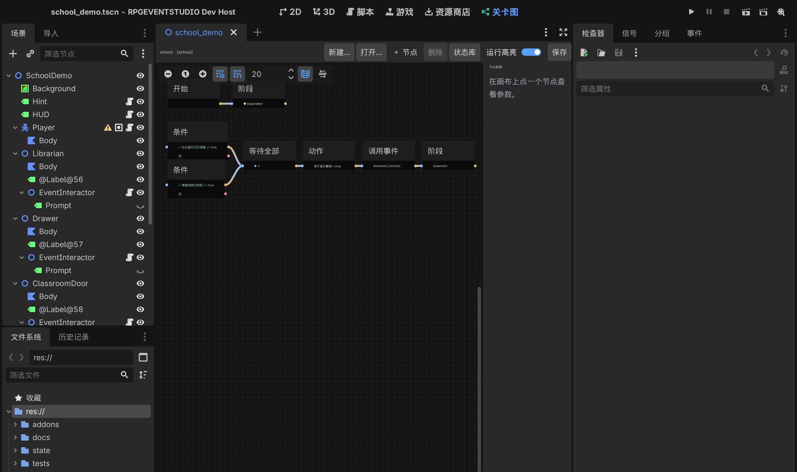

# 13 · 关卡总控图（第二阶段交付）

> 对应需求文档 §5、§17 第二阶段。
> 验收目标：玩家调查两个不同地点，两处都完成后**自动解锁地下室**——不需要为关卡写任何脚本。

---

## 1. 本轮做了什么

| 能力 | 状态 |
| --- | --- |
| 关卡图数据模型（节点 / 连线 / 入口） | ✅ |
| 图执行器：令牌流、并行分支、AND / OR 汇合 | ✅ |
| 关卡阶段（进入阶段 = 写 `School.Stage` + 广播） | ✅ |
| 条件节点（含「持续监视」，状态变了自动重算） | ✅ |
| 动作节点（写状态） | ✅ |
| 事件节点（调用局部事件，可等它结束） | ✅ |
| 结束节点（写完成标记 + 通知） | ✅ |
| 编辑器主屏「关卡图」：看图、加节点、连线、改参数、删除、撤销、保存 | ✅ |
| 演示关卡：两处调查 → 自动解锁地下室 | ✅ |
| 运行中高亮当前阶段 | ⬜ 下一轮（需要编辑器与游戏进程通信） |
| 子图、超时分支、排队重入、分组 | ⬜ 按需再加 |

---

## 2. 数据模型

```
LevelGraph (Resource)
├─ graph_id, level_id, entry_node, schema_version
├─ nodes: Array[LevelNode]
└─ connections: Array[LevelConnection]
```

**LevelNode**

| 字段 | 说明 |
| --- | --- |
| `node_id` | 图内唯一，同时是 GraphNode 的节点名（画布与数据一一对应） |
| `type` | start / stage / condition / action / event / merge_and / merge_or / end |
| `title` | 预留显示名（当前用类型名） |
| `params` | 按类型不同的参数字典 |
| `position` | 画布坐标 |
| `reentry` | drop / queue / restart（当前实现 drop 语义，字段预留） |
| `enabled` | 关掉后令牌到此为止 |

**LevelConnection**

```
from_node, from_port, to_node, to_port
```

端口用**名字**（`out` / `true` / `false` / `done` / `in`），不用下标：以后给节点加端口，旧连线不会串位。

### 节点类型与参数

| 类型 | 端口 | 参数 | 行为 |
| --- | --- | --- | --- |
| `start` | out | — | 关卡入口，启动时激活一次 |
| `stage` | in → out | `stage_id`、`label` | 写 `<关卡>.Stage`，广播 `stage_changed`，继续传播 |
| `condition` | in → true / false | `key`、`op`、`value`、`monitor` | 求值后走对应端口；`monitor=true` 时状态变化自动重算 |
| `action` | in → out | `key`、`op`(set/add/toggle)、`value` | 改状态后继续 |
| `event` | in → done | `event_path`、`wait` | 调事件；`wait=true` 时等事件结束再继续 |
| `merge_and` | in×N → out | `required`（0 = 全部入边） | 收齐指定数量的令牌才继续 |
| `merge_or` | in×N → out | — | 任一令牌即继续 |
| `end` | in | `completed_key` | 写完成标记，广播图结束 |

---

## 3. 执行模型

### 3.1 令牌流

- 启动时从 `start` 递一个令牌，节点被激活后按端口把令牌传给下游。
- 传播是**同步**的（一次激活链在一个帧内走完）；只有事件节点会挂起等待。
- 每次激活都记一笔 `node_activated`，供调试与未来的编辑器高亮使用。

### 3.2 条件监视（解锁类逻辑的核心）

```
condition(monitor) 在关卡开始时不做传播，只登记：
   key = School.Office.DiaryFound
   记录当前结果
状态每次变化 → 看是否命中自己的 key → 重新求值
   结果从 false 变 true → 从 true 端口发一次令牌
   从 true 变 false → 从 false 端口发一次令牌
```

这样做的关键好处：**不依赖事件是否发通知、是否在读档后重放**。只要状态是真的，图就会推进；读档、重新进入关卡、中途启用图都能正确工作。

### 3.3 AND 汇合

`merge_and` 记录收到几个令牌：

```
required = 参数值，若为 0 则用入边数量
count >= required → 发一次 out，同时标记 fired
fired 之后再来的令牌直接丢弃
```

因此「办公室 + 教室都完成」只会解锁一次，不会因为状态反复变化重复触发。

### 3.4 事件节点

```
event_starter.call(definition, {}, ["interact"])
wait=true → 监听 bus.event_finished，匹配 event_id 后继续
wait=false → 立即继续（适合"提示一下但不等玩家"）
```

事件节点让图可以主动播放演出/对话；反过来，局部事件只写状态，由条件节点接住——两个方向都不需要互相知道对方存在。

### 3.5 防护

| 风险 | 处理 |
| --- | --- |
| 环路导致无限传播 | 单次运行累计激活超过 4000 次即中止并报错 |
| 事件永不结束 | 等待上限 120 秒（调试期可改） |
| 重复解锁 | `merge_and` fired 标记 |
| 监控条件抖动 | 只在**结果翻转**时发令牌 |
| 状态写入引发递归 | 状态变化触发的重算走 `call_deferred`，排在当前传播之后 |

---

## 4. 编辑器（主屏「关卡图」）

顶部工具栏：`打开…` / `＋ 节点` / `删除` / `保存`，右侧是节点参数面板。

- **打开**：从资源里选一个 `LevelGraph` `.tres`；或者在文件系统里选中它，编辑器会自动打开。
- **加节点**：菜单里 8 种类型，落在当前视口中心。
- **连线**：从节点右侧圆点拖到另一个节点左侧；**不能连到「开始」节点**，不能自连，重复连线会被忽略。
- **断开**：从连线上拖开（GraphEdit 的右键断开也支持）。
- **删除**：选中节点按 Delete，或工具栏「删除」；连带删除相关连线。
- **改参数**：点节点 → 右侧面板出现对应字段（状态名、比较符、值、是否监视、事件资源、需要几条输入……），改动即时写回资源。
- **撤销 / 重做**：加节点、删节点、连线、断线、改参数都进 `EditorUndoRedoManager`（`custom_context = LevelGraph`），与场景撤销互不干扰。
- **保存**：写回原 `.tres`。



> 节点显示的 `exploration` / `School.BasementUnlocked = true` 等就是参数摘要，不用点开也能看懂图在做什么。

---

## 5. 演示关卡

`addons/rpgeventstudio/samples/graphs/school_graph.tres`：

```
                      ┌── 条件：School.Office.DiaryFound == true ──┐
开始 ──► 阶段：探索 ──┤                                            ├──► 等待全部(2) ──► 动作：解锁地下室 ──► 调用事件：提示 ──► 阶段：地下室
                      └── 条件：School.Classroom.ClueFound == true ┘
```

- 进入场景时 `LevelGraphRunner2D` 启动这张图 → 阶段变「探索」。
- 调查**办公室桌子** → 事件写 `School.Office.DiaryFound = true` → 条件 1 发令牌。
- 调查**教室黑板** → 写 `School.Classroom.ClueFound = true` → 条件 2 发令牌。
- 两个令牌凑齐 → 解锁 `School.BasementUnlocked` → 播放「远处传来铁门开启的声音……」→ 阶段切到「地下室」。
- 左上角 HUD 第二行实时显示 `阶段：探索 / 地下室`、`地下室：未解锁 / 已解锁`。

整个流程没有为关卡写一行脚本：调查事件是配置出来的，图的推进是状态驱动的。

---

## 6. 与设计文档的差异

| 设计文档 | 本轮实现 | 原因 |
| --- | --- | --- |
| `StageDefinition` 资源 + 转移表 | 阶段节点直接写 `<关卡>.Stage`，阶段名走翻译键 | 先跑通主流程；转移表的价值在"阶段很多"时才显现 |
| `GraphRuntimeState` 独立类 | 运行状态在 `GraphRunner` 里（`node_states` 等字典） | 减少一层间接；存档阶段再抽出来 |
| 重入策略 drop/queue/restart | 字段保留，统一按 drop 处理 | 目前没有需要排队的场景 |
| 运行中高亮 | 执行器已经发 `node_activated` 信号，编辑器侧还没接 | 需要编辑器与游戏进程通信，单独一轮 |
| 图校验器（不可达/环路） | 只有运行期防护 | 静态分析下一轮补 |

---

## 7. 测试

| 命令 | 覆盖 | 数量 |
| --- | --- | --- |
| `tests/run.gd` | 图：开始→阶段、条件监视、AND 汇合、OR 汇合、事件节点等待；另有条件默认值回归 | 82 |
| `tests/graph_editor_smoke.gd` | 图编辑器：加载、节点数一致、加节点、连线、拒绝连回起点、改参数、保存重读、删除连带连线 | 14 |
| `tests/integration_demo.gd` | 真实场景：调查两处 → 自动解锁 → 阶段切换 → HUD 显示；外加钥匙/开门/改键/语言 | 33 |

合计（含其它套件）**188 项，全部通过**。

---

## 8. 本轮修掉的一个旧 bug

调试中发现：条件 `某状态 == false` 在状态**从未被写过**时会被判为「不满足」，导致新建事件的默认页永远不生效（第一阶段的抽屉事件其实就踩到了，只是当时测试没直接触发它）。

修复：未定义状态按 `false` 参与布尔比较（`== false` 成立、`!= true` 成立），并在 `tests/run.gd` 里加了回归用例。这个修复同时让"第一次调查"类事件能正常工作——也就是本轮验收能跑通的前提。

---

## 9. 已知限制

1. 图编辑器目前一次只开一张图，没有标签页；换图请用「打开…」。
2. 节点没有分组框（GraphFrame），大图会显得散，下一轮加。
3. 没有静态校验（不可达节点、环路提示），只有运行期防护。
4. 主屏按钮的文字在编辑器启动时确定，切换编辑器语言后需要重启才更新（面板内部文字会立即更新）。
5. 图的 `end` 节点只写完成标记，还没有「解锁下一关」的跨关卡逻辑（等存档/关卡管理一起做）。
6. 事件节点固定用 `interact` 触发过滤；如果事件页写的是「自动执行」，从图里调用会找不到页——下一轮让事件节点可选触发方式。
