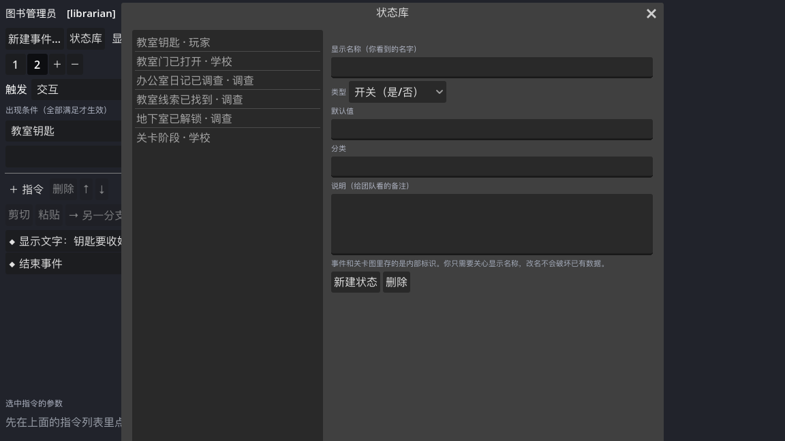
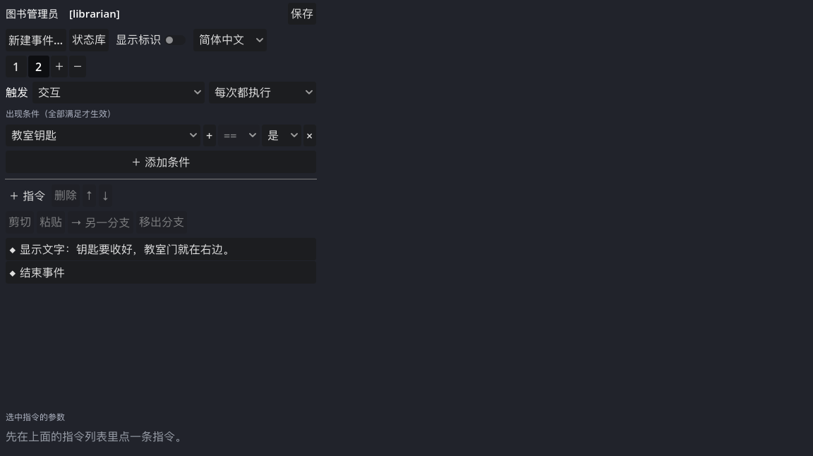
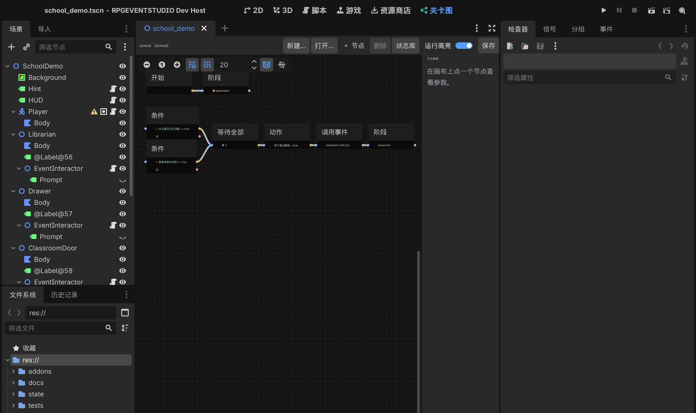
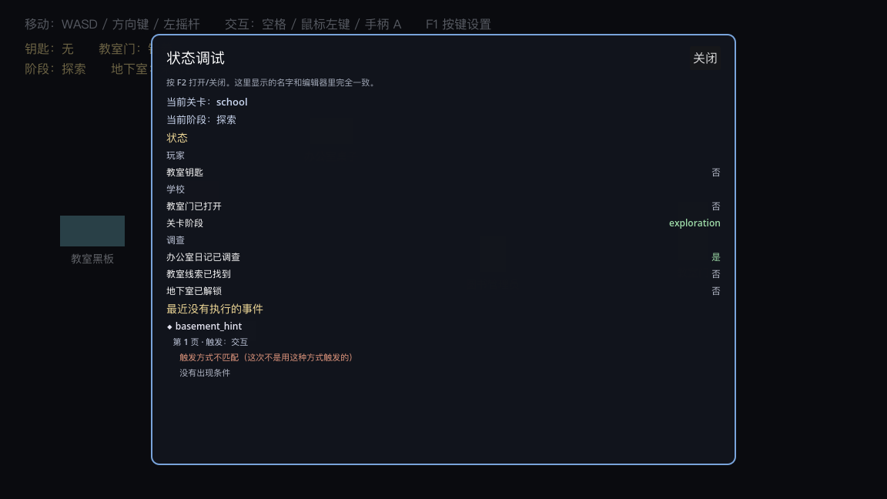

# 14 · 上手教程：从零做一段「两条线索解锁地下室」的剧情

> 这份教程只讲**在编辑器里点哪里、填什么、应该看到什么**，不讲内部原理。
> 所有按钮名称与当前工程一致（Godot 4.7，插件 v0.4）。
> 跟着做一遍大约 20 分钟；做完你会得到：两个调查点、一个关卡图、一段解锁后的剧情。

---

## 0. 开始之前

1. 用 Godot **4.7** 打开 `RPGEVENTSTUDIO/project.godot`。
2. 认识三个地方：
   - **左边**：场景树 / 文件系统。
   - **右边**：`检查器` 旁边的 **「事件」** 面板（插件加的）。
   - **顶部**：`2D` `3D` `脚本` 旁边多出来的 **「关卡图」** 主屏。
3. 记两个键：**F5 运行游戏**，**F2 打开状态调试**（游戏里）。

先按 F5 把演示关跑一遍：

- 走到「图书管理员」按空格 → 选「询问钥匙」→ 拿到钥匙
- 去右边「教室门」→ 门打开
- 调查左上「办公室桌子」、左下「教室黑板」
- 两处都调查完 → 左上角变成 `阶段：地下室　地下室：已解锁`，并弹一句台词

**你现在要学的，就是把这套东西自己做出来。**

---

## 1. 先理解三件事（用大白话）

| 概念 | 在工具里是什么 | 你要关心什么 |
| --- | --- | --- |
| **事件** | 挂在某个东西上的「一页一页的指令」 | 玩家和它交互时发生什么 |
| **状态** | 一个「是/否」或「数字/文字」的开关，有名字 | 「办公室日记已调查」这类游戏事实 |
| **关卡图** | 一张连线的图，盯着状态自动推进剧情 | 「两条线索都齐了 → 解锁地下室」 |

一句话记法：

> **事件负责「做事」，状态负责「记住」，关卡图负责「在合适的时机推进」。**

---

## 2. 第一步：先登记你要用的状态

状态就是剧情里的「事实」。你不需要知道它在程序里叫什么。

1. 在右侧 **「事件」** 面板顶部，点 **「状态库」**。
2. 弹窗里左边是已有状态列表，右边是表单。
3. 点 **「新建状态」**，右侧出现一条空状态：
   - **内部标识**：`School.Office.DiaryFound`（程序与存档用，随便起但建议有规律）
   - **显示名称**：`办公室日记已调查` ← **以后你在界面里只会看到这个**
   - **类型**：`开关（是/否）`
   - **默认值**：`false`
   - **分类**：`调查`
   - **说明**：`调查办公室桌子后为真`
4. 关掉窗口。这个状态就保存在 `res://state/state_catalog.tres` 里了。

同样再建两个：

| 内部标识 | 显示名称 | 类型 | 默认 | 分类 |
| --- | --- | --- | --- | --- |
| `School.Classroom.ClueFound` | 教室线索已找到 | 开关 | false | 调查 |
| `School.BasementUnlocked` | 地下室已解锁 | 开关 | false | 调查 |

> 演示工程里这三个已经建好了，你可以直接跳过这一步；想练手就先删掉再建一遍。
>
> **关键点**：以后改「显示名称」只改这里，事件和关卡图里存的永远是内部标识——**改名不会弄坏任何东西**。



---

## 3. 第二步：做一个「调查办公室」事件

### 3.1 新建事件文件

1. 在场景里选中 **`OfficeDesk/EventInteractor`** 节点（场景树里展开 `OfficeDesk` 就能看到）。
2. 在右侧「事件」面板点 **「新建事件…」**。
3. 在弹出的保存框里输入 `res://events/office_desk.tres`，点保存。

**你会看到**：面板标题变成 `office_desk [office_desk]`，下方出现 `[1] [＋]` 页签，列表是空的。
同时，这个新事件会自动挂到刚才选中的节点上（`event_path` 已填好），不用再手动拖。

### 3.2 加一条「出现条件」

目标：第一次调查才给线索，之后再来就说「看过了」。

1. 点 **「＋ 添加条件」**。
2. 条件行里，第一个下拉框点开——**里面是中文名字，不是内部标识**。选 `办公室日记已调查`。
3. 选择后，中间的比较符自动锁成 `==`，右边自动变成 **「是 / 否」** 下拉。选 **「否」**。

**你会看到**：条件行显示 `办公室日记已调查  ==  否`。

> 这一步的含义：**当「办公室日记已调查」还是「否」的时候，这一页生效。**

### 3.3 加指令

1. 点 **「＋ 指令」** → 选 **`显示文字`**。
2. 下方「选中指令的参数」里：
   - **说话人**：留空
   - **内容**：`桌上摊着一本教师日志，最后一页写着：地下室的门需要两把钥匙。`
3. 再点 **「＋ 指令」** → 选 **`设置开关`**。
4. 参数里：
   - **开关**：点下拉，选 `办公室日记已调查`
   - **开**：勾上（这就是「设为真」）
5. 再点 **「＋ 指令」** → **`显示文字`**，内容填 `获得线索：教师日志`。
6. 最后 **「＋ 指令」** → **`结束事件`**。

**你会看到**：指令列表像这样——

```
◆ 显示文字：桌上摊着一本教师日志……
◆ 设置开关：办公室日记已调查 = ON
◆ 显示文字：获得线索：教师日志
◆ 结束事件
```

7. 点面板右上角 **「保存」**。

### 3.4 再加一页「已经调查过」

1. 点页签旁边的 **`＋`**（在 `[1]` 右边）→ 出现 `[2]`，并且自动切到第 2 页。
2. 点 **「＋ 添加条件」** → 选 `办公室日记已调查`，值选 **「是」**。
3. 加指令：`显示文字` → `日志已经翻完了。`，再 `结束事件`。
4. **「保存」**。

> **页的优先级**：两页同时满足时，**右边的页码更大**的生效。所以「已调查」的页放在第 2 页；不要把它放到第 1 页。



---

## 4. 第三步：把事件挂到场景对象上

演示工程已经挂好了，你自己新建对象时这样做：

1. 选中要交互的节点（比如 `OfficeDesk`）。
2. 菜单「添加子节点」→ 搜 **`EventInteractor2D`** → 添加。
3. 在检查器里设置：
   - **Event Path**：`res://events/office_desk.tres`（**推荐用路径**，改事件文件后游戏立刻生效）
   - **Interaction Radius**：`78`（玩家离多近能交互）
   - **Prompt Text**：留空就用默认的「▲ 交互」
4. 保存场景（`Ctrl+S`）。

**你会看到**：节点下多了一个 `EventInteractor`，运行时玩家靠近会显示「▲ 交互」。

三种组件怎么选：

| 组件 | 什么时候用 |
| --- | --- |
| `EventInteractor2D` | 需要玩家按交互键的：NPC、门、抽屉、告示牌 |
| `EventTriggerArea2D` | 玩家走进一片区域就触发：剧情触发点、机关 |
| `EventAutoRun2D` | 不需要玩家操作、条件满足自动播：过场、演出 |

---

## 5. 第四步：做第二个调查点

复制第一条的思路，做一个「教室黑板」事件：

- 选中 **`ClassroomBoard/EventInteractor`**
- 「新建事件…」→ 存成 `res://events/classroom_board.tres`
- 第 1 页条件：`教室线索已找到 == 否`
- 指令：`显示文字`「黑板上留着奇怪的粉笔痕，像是某种开门顺序。」→ `设置开关` `教室线索已找到 = ON` → `显示文字`「获得线索：异常的粉笔痕」→ `结束事件`
- 第 2 页条件：`教室线索已找到 == 是` → 一句「粉笔痕已经被记下来了。」→ `结束事件`
- **保存**

> 偷懒办法：在文件系统里复制 `office_desk.tres`，改名后在「事件」面板里改文字和状态。复制出来的是独立文件，互不影响。

---

## 6. 第五步：做关卡图（自动推进的部分）

### 6.1 什么时候该用关卡图？

| 你的需求 | 放哪 |
| --- | --- |
| 和某个 NPC/门/抽屉交互发生什么 | **局部事件** |
| 「拿到钥匙才能开门」这种单点判断 | **局部事件里的条件**（几行就够） |
| 多个地点、任意顺序、都完成后才推进 | **关卡图** |
| 阶段变化（探索 → 追逐）、解锁区域、切 BGM | **关卡图** |
| 一段多角色演出 | **局部事件**（关卡图只负责调用它） |

一句话：**单点用事件，跨地点/跨阶段用图。**

### 6.2 新建一张图

1. 点顶部主屏 **「关卡图」**。
2. 点 **「新建…」**，存成 `res://levels/school_graph.tres`。

**你会看到**：画布上已经有一个 **`开始`** 节点（别删它），右侧显示「节点参数」。

### 6.3 加节点

点 **「＋ 节点」**，菜单里选你要的类型。我们需要的节点：

| 节点 | 你填的参数 |
| --- | --- |
| `阶段` | 阶段 ID：`exploration` |
| `条件` | 状态：`办公室日记已调查`；比较：`==`；值：`是`；勾选「持续监视」 |
| `条件` | 状态：`教室线索已找到`；值：`是`；勾选「持续监视」 |
| `等待全部` | 需要几条输入：`2` |
| `动作` | 状态：`地下室已解锁`；操作：`设为`；值：`是` |
| `阶段` | 阶段 ID：`basement` |

**关键：一定要勾「持续监视」。** 勾上之后，状态一变图就会自己重新判断；不勾就只在开头判断一次。

### 6.4 连线

从**节点右侧的圆点**按住拖到**另一个节点左侧的圆点**，松开即可。

按这个顺序连：

```
开始 ──────────────► 阶段(exploration)
条件(办公室日记) ──是──► 等待全部
条件(教室线索) ──是──► 等待全部
等待全部 ──────────► 动作(地下室已解锁)
动作 ──────────────► 阶段(basement)
```

注意：

- 条件节点有**两个出口**：上面是「是」，下面是「否」。我们只连「是」。
- 连线不能连到「开始」节点。
- 连错了：从连线上按住拖开，或右键断开。

### 6.5 检查参数

看画布下方那行字：

- 绿色 **「参数检查：没有发现问题」** = 可以了；
- 橙色 **「⚠ N 个节点还需要填参数：…」** = 按提示点开对应节点补上。

点 **「保存」**。



---

## 7. 第六步：解锁后播一段剧情

在图里再加一个 **`调用事件`** 节点，让它在解锁后播放一句话：

1. `＋ 节点` → **`调用事件`**。
2. 参数：
   - **事件资源**：点 `…` 选一个事件文件（例如 `basement_cutscene.tres`）
   - **触发方式**：默认 `interact`。**如果被调用的事件页写的是「自动执行」，这里要改成 `autorun`**，否则图找不到那一页（F2 会显示「触发方式不匹配」）。
   - **等待事件结束**：**不勾**（不勾 = 放完提示就继续推进，不等玩家关掉）
3. 连线：`动作(地下室已解锁)` → `调用事件` → `阶段(basement)`。

如果想等对话结束再切阶段，就把「等待事件结束」勾上。

> 要让 NPC 说一长段话，就把这段对话做成一个**局部事件**（第 3 步那样），然后在这里用「调用事件」引用它——关卡图不需要知道对白内容。

---

## 8. 第七步：运行、检查

1. **F5** 运行。
2. 调查办公室桌子和教室黑板各一次。
3. 期望看到：
   - 每调查一处，左上角状态 HUD 不变（线索是内部状态）；
   - 两处都完成后，弹出「远处传来铁门开启的声音……」；
   - HUD 第二行变成 `阶段：地下室　地下室：已解锁`。
4. 游戏里按 **F2** 打开「状态调试」，能看到：
   - `办公室日记已调查：是`、`教室线索已找到：是`、`地下室已解锁：是`（**显示名与你编辑器里看到的一致**）
   - 如果某条是「否」，说明对应事件没跑到那一步。
   - 最下面的「最近没有执行的事件」会逐页逐条件说明为什么没播。



---

## 9. 出了错怎么查

### 9.1 交互没反应

按顺序检查：

1. **组件在不在**：选中对象，看有没有 `EventInteractor` 子节点。
2. **路径填没填**：`Event Path` 是否指到 `.tres`；保险起见把 `Event` 也拖进去。
3. **站得够近吗**：`Interaction Radius` 默认 78，站到对象旁边（会显示「▲ 交互」）。
4. **是不是另一个对象更近**：多个交互对象重叠时，**只让最近的那个响应**。
5. **事件是不是正在播**：一个事件没结束时，交互会被锁住。

### 9.2 事件进去了，但走错页

看「出现条件」：

- 条件里的「是/否」是不是反了；
- 页码顺序：**兜底页放第 1 页，带条件的页放后面**；
- 状态值到底是多少——按 **F2** 看一眼，比猜快。

### 9.3 事件根本没触发，但不知道原因

**F2 面板最下面「最近没有执行的事件」** 会直接告诉你：

```
◆ office_desk
   第 1 页 · 触发：交互
      ✗ 办公室日记已调查（现在是 是，要求 == 否）
```

或者：

```
   第 1 页 · 触发：交互
      触发方式不匹配
```

第二种情况说明：这个事件的页写的是「自动执行 / 进入区域」，但你是用交互键触发的（或者关卡图用「调用事件」调它，而它的事件页不是「交互」）。

### 9.4 关卡图不动

1. 画布下方有没有橙色「N 个节点还需要填参数」；
2. 条件节点有没有勾 **「持续监视」**；
3. `等待全部` 的「需要几条输入」是不是 2（0 = 用入边数量）；
4. 图有没有真的跑起来：场景里要有 **`GraphRunner`** 节点，`Graph Path` 指向这张图；
5. 按 **F2** 看状态：条件依赖的状态是不是「否」。

### 9.5 找不到事件 / 不知道图跑到哪

- **找不到事件**：右侧拉出 **「事件列表」** 停靠面板，列表里有全部事件和关卡图；搜索框输入名字或文件路径，**双击**就会打开。
- **想看图的运行进度**：在「关卡图」主屏勾上 **运行高亮**，然后按 F5 **从编辑器启动**游戏。
  回到编辑器可以看到节点前的标记：`▶` 正在执行、`✓` 已完成、`●` 当前阶段。
  （只有在编辑器里启动游戏才会收到状态；直接开可执行文件不会。）

### 9.6 改了东西没生效

- 事件/图的改动要点**「保存」**；
- 游戏里改了 `.tres` 要重新 F5；
- 状态改名后，事件里显示的是新名字，但内部标识没变——不需要迁移。

---

## 10. 以后怎么扩展

| 想加什么 | 怎么做 |
| --- | --- |
| 再加一个调查点 | 复制一个调查事件 → 改状态 → 图里加一个「条件」并连到「等待全部」，把「需要几条输入」改成 3 |
| 加一段 NPC 对话 | 新建事件，用「显示文字 / 显示选项 / 条件分歧」编排；图里用「调用事件」引用，或直接挂到 NPC 的 `EventInteractor2D` |
| 让剧情分叉 | 事件里用「条件分歧」；图里用「条件」的「是 / 否」两个出口分别连不同的后续 |
| 换阶段（探索→追逐） | 图里加「阶段」节点，阶段 ID 换掉；HUD / 事件条件都可以读 `阶段` |
| 让某段演出播完再继续 | 「调用事件」节点勾上「等待事件结束」 |
| 改状态显示名 | 打开「状态库」改「显示名称」，保存。**事件和图都不用动。** |
| 给旧事件补登记状态 | 打开那个事件，条件行里会显示 `⚠ xxx（未登记）`，点右边的 `+` 登记并改名即可 |

---

## 11. 一张速查表

| 我现在想… | 去哪个界面 | 点哪个按钮 |
| --- | --- | --- |
| 新建一个可交互的事件 | 选中对象 → 右侧「事件」 | **新建事件…** |
| 管理状态名字 | 右侧「事件」或「关卡图」 | **状态库** |
| 加一条指令 | 右侧「事件」 | **＋ 指令** |
| 加分支指令 | 指令列表里的「是 / 否」右侧 | **＋** |
| 看内部标识（排查用） | 右侧「事件」 | 勾 **显示标识** |
| 新建关卡图 | 顶部「关卡图」主屏 | **新建…** |
| 加图节点 | 「关卡图」 | **＋ 节点** |
| 查图参数有没有漏 | 「关卡图」画布下方 | 看自动检查那行 |
| 运行游戏 | 任意 | **F5** |
| 看状态 / 为什么没触发 | 游戏里 | **F2** |
| 找不到刚做的事件 | 右侧「事件列表」面板 | 搜索框输入名字，**双击**打开 |
| 看某张图运行到哪了 | 顶部「关卡图」主屏 | 勾 **运行高亮**，再按 F5 从编辑器启动 |
| 改键 | 游戏里 | **F1** |

---

## 12. 演示工程里对应的真实文件

| 内容 | 文件 |
| --- | --- |
| 办公室调查事件 | `addons/rpgeventstudio/samples/events/office_desk.tres` |
| 教室调查事件 | `addons/rpgeventstudio/samples/events/classroom_board.tres` |
| 解锁后的提示事件 | `addons/rpgeventstudio/samples/events/basement_cutscene.tres` |
| 关卡图 | `addons/rpgeventstudio/samples/graphs/school_graph.tres` |
| 状态库 | `state/state_catalog.tres` |
| 演示场景 | `addons/rpgeventstudio/samples/scenes/school_demo.tscn` |

想对照着学：打开 `school_graph.tres` 看节点和连线，再打开 `office_desk.tres` 看它是怎么写状态、图是怎么接住的。
