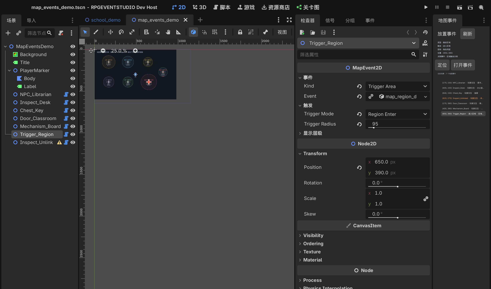

# 地图事件放置与图层

目标：地编在 Godot 2D 场景里直接摆放、移动、分层和管理事件对象；事件编辑器只管剧情内容，
2D 视图和 Inspector 管空间布局。**没有重做一套地图编辑器**。

## 分工

| 能力 | 由谁提供 |
| --- | --- |
| 选中、拖动、框选、吸附、旋转、缩放、复制节点 | Godot 原生 2D 编辑器 |
| 场景树、节点命名、owner、保存 | Godot 原生场景系统 |
| `z_index` / `z_as_relative` / YSort | Godot 原生 `CanvasItem` |
| 物理碰撞 | Godot 原生 `StaticBody2D` / `CollisionShape2D` |
| 事件对象、类型、触发方式、层级预设 | 插件 `MapEvent2D` |
| 交互 / 进入 / 离开 / 自动执行的运行逻辑 | 复用 `EventInteractor2D` / `EventTriggerArea2D` / `EventAutoRun2D` |
| 场景事件总览、定位、打开事件、失效引用提示 | 插件「地图事件」面板 |

`MapEvent2D` 不生成美术资源，也不替代碰撞体。它只画编辑期占位图标、交互/触发范围，
运行时按配置挂上已有组件。需要实体阻挡时，在 `MapEvent2D` 下添加自己的
`StaticBody2D + CollisionShape2D`。

## 放置 / 关联事件

1. 打开一个 2D 场景。
2. 右侧「地图事件」面板 →「放置事件」→ 选择 NPC、调查点、宝箱、门、机关或触发区域。
   - 新节点会放在当前选中节点下；没有选中则放在场景根节点下。
   - 位置默认取当前 2D 视口中心；之后直接用 Godot 的移动工具拖动。
   - 放置走 `UndoRedo`，可以 Ctrl+Z / Ctrl+Y。
3. 选中新节点，在 Inspector 里：
   - `Event`：拖入已有 `.tres` 事件资源；
   - `Trigger Mode`：玩家交互 / 进入区域 / 离开区域 / 自动执行 / 并行执行；
   - `Layer Mode`：角色下方 / 同层 / 上方 / 自定义；
   - `Interaction Radius` 或 `Trigger Radius`：可视化范围。
4. 「地图事件」面板中双击一行，或选中后点「打开事件」，直接切到事件编辑器。
5. 不需要写 GDScript，也不需要手改 `.tres`。

`Event` 留空时，可以改用 `Event Path` 填文件路径；Inspector 会在未关联、路径失效、
资源不是事件、事件没有匹配触发页时显示黄色/红色警告。

## 事件页优先级 ≠ 地图层级

这是两个完全不同的概念：

| 概念 | 作用 |
| --- | --- |
| 事件多页 / 条件优先级 | 决定“这一次执行哪一页指令”，在事件编辑器里 |
| `MapEvent2D.position` | 地图坐标，决定对象在哪 |
| `MapEvent2D.layer_mode` | 决定视觉上在玩家下方/同层/上方 |
| `z_index` / YSort | Godot 实际绘制顺序 |
| `interaction_radius` | 玩家靠近多远能交互 |
| `trigger_radius` | 进入/离开判定半径 |
| 物理碰撞体 | 是否阻挡移动，完全是 Godot 原生节点 |

事件页的优先级高，不代表这个对象会显示在更上层。

## 图层映射

| 模式 | 实际设置 | 说明 |
| --- | --- | --- |
| Below Player | `z_as_relative = true`，`z_index = -1` | 相对父节点低于玩家一层 |
| Same Layer | `z_as_relative = true`，`z_index = 0` | 与玩家同层；父节点开 YSort 时按 Y 排序 |
| Above Player | `z_as_relative = true`，`z_index = 1` | 高于玩家一层 |
| Custom z_index | 直接使用 `custom_z_index` | 需要更细的层时用；保留原生 `z_index` 能力 |

注意：

- 这是一组**相对玩家 z_index = 0** 的预设。通常地板应放在 `z_index <= -2`，
  否则「角色下方」的事件会被地板挡住；更复杂的分层请用 Custom 或原生 `z_index`。
- 只有同层对象才应该依赖父节点的 YSort；上下层用 `z_index` 覆盖。
- `MapEvent2D` 自己画的是编辑期占位图标，实际美术可以是它的子节点（Sprite2D / AnimatedSprite2D 等）。

## 触发区域

| 触发模式 | 运行时组件 | 传给的触发过滤 |
| --- | --- | --- |
| Interact | `EventInteractor2D` | `interact` |
| Region Enter | `EventTriggerArea2D`（只开进入） | `touch` + `region_enter` |
| Region Exit | `EventTriggerArea2D`（只开离开） | `region_exit` |
| Autorun | `EventAutoRun2D` | `autorun` |
| Parallel | `EventAutoRun2D`（is_parallel） | `parallel` |

- 编辑器里：交互模式画交互半径，进入/离开模式画触发半径。
- 运行时：仍由现有组件决定是否触发；本功能只增加 `trigger_on_enter` / `trigger_on_exit`
  两个开关，默认都开，旧场景行为不变。
- 现有 `EventTriggerArea2D` 用的是距离判定，不是 Physics Area2D；如果项目以后要换成
  形状触发，可以在不改事件资源的前提下替换组件实现。

## 地图事件总览

右侧「地图事件」面板列出当前编辑场景的所有 `MapEvent2D`：

- 行内显示：位置、节点名、触发方式、关联事件或状态；
- 未关联 / 路径失效 / 非事件资源：橙色提示，悬停可看完整路径；
- 「定位」：选中场景对象；
- 双击 / 「打开事件」：在事件编辑器打开关联事件；
- 「放置事件」：生成新对象并登记 UndoRedo；
- 每 0.6 秒检查一次位置/关联变化，移动节点后总览会跟着刷新。

## 示例

场景：`addons/rpgeventstudio/samples/scenes/map_events_demo.tscn`

包含 NPC、调查点、宝箱、门、机关、进入区域和一个未关联对象；打开后可用 2D 编辑器直接拖动，
并在右侧面板看到类型、层级、触发方式和事件资源。



## 验收

```bash
# 运行时对象 / 组件挂载 / 层级映射 / 配置警告
godot --headless --path . --script res://tests/run.gd

# 真实编辑器：打开场景、选中、放置、Undo/Redo、定位、打开事件、失效引用
RPGEVENTSTUDIO_MAP_SELFTEST=1 godot --headless --editor --path . --quit-after 3000

# 真实编辑器截图
RPGEVENTSTUDIO_MAP_SHOT=1 godot --editor --path . --quit-after 3000
```

## 本轮边界

- 不做自由绘制式地图编辑器；地图本身继续用 Godot 2D 编辑器。
- 不生成美术、不管理素材导入、不做寻路/导航。
- 不改变事件资源格式、事件页优先级、关卡总控图或已有运行时剧情。
- 交互/触发范围目前是圆形距离；物理碰撞仍是原生节点。
- 未关联 / 引用失效会给警告，但不会自动删除对象或资源。

## 验收记录（2026-10-29）

| 测试 | 结果 |
| --- | --- |
| `tests/run.gd`（含地图事件对象/组件/层级/警告/四种触发） | 185 项，0 失败 |
| `RPGEVENTSTUDIO_MAP_SELFTEST=1 … --headless --editor` | 50 项，0 失败（含主题页检查） |
| `tests/ui_smoke.gd`（事件编辑器） | 56 项，0 失败 |
| `tests/integration_demo.gd` | 37 项，0 失败 |
| `tests/interaction_test.gd` | 19 项，0 失败 |
| `tests/tutorial_flow.gd` | 14 项，0 失败 |
| `tests/event_list_smoke.gd` | 13 项，0 失败 |
| `tests/graph_editor_smoke.gd` | 19 项，0 失败 |
| `tests/node_ref_test.gd` | 12 项，0 失败 |

编辑器自测覆盖：打开示例场景、场景事件计数、总览字段、未关联/失效引用提示、选中同步、
双击打开事件、面板放置、owner、默认触发/层级、Undo/Redo、定位按钮。

编辑器截图 `docs/images/map_events_editor.png` 是在真实 Godot 编辑器中打开示例场景、
选中 `Trigger_Region` 后截取的；可以看到 2D 视口的交互/触发范围、Inspector 的 MapEvent2D 参数、
以及右侧「地图事件」总览。

本轮没有改动《做题家小游戏》的工程脚本；该功能是插件通用的，不包含游戏专用逻辑。
