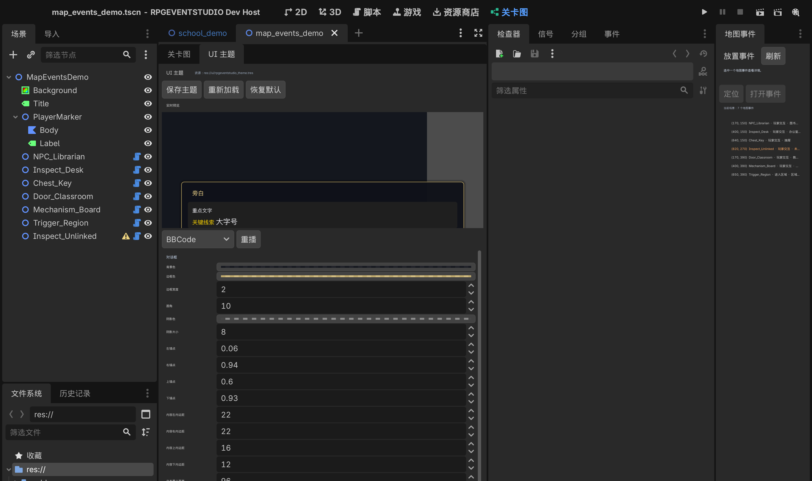

# UI 主题定制

主题只作用于**插件默认展示层**（`DialoguePresenter` 和交互提示），不会覆盖游戏注入的自定义
presenter。资源属于游戏项目：`res://ui/rpgeventstudio_theme.tres`。

第二批主题预设的完整说明、架构与截图见 [22-对话主题预设](22-对话主题预设.md)。
本次提供 10 套可切换预设（第一弹 4 套 + 第二弹 2 套 + 第四轮重制 4 套），
按需求排除“纯白神谕”“浮生水墨”两套。

## 主题页

编辑器主屏 →「关卡图」→ 内部标签「UI 主题」。

- 左侧/上方：实时预览，使用真实的 `DialoguePresenter` 实例，预览普通文本、BBCode、多行和选项。
- 下方：可滚动参数区。
- 顶部：保存主题 / 重新加载 / 恢复默认；实时显示状态。
- 修改参数立即应用到预览和当前编辑器运行时；不会每改一次就写盘。

参数分组：

| 分组 | 内容 |
| --- | --- |
| 对话框 | 背景、边框、圆角、阴影、锚点、内边距、文本最小高度；面板轮廓（矩形/缺口/斜切/电影/八角/碎晶）、缺口/斜切尺寸、装饰边框（双层/角花/缝线/刀锋/刻度线/装甲条/蕾丝/渐隐金丝）、内框、角饰（含旋转星盘/振翅冥蝶）、渐变、底纹、硬阴影、主/副强调色、顶刃、装甲条 |
| 文字 | 字体文件、标题/正文字族、基础字号、正文颜色/字号、对齐、描边、行距、打字速度、说话人颜色/字号、提示颜色/字号 |
| 选项 | 选项面板内边距/间距/高度/字号、与对话框间距；选项面板（带面板/独立成形）、形状（矩形/胶囊/斜切/便签/竖线/缺口/羽翼/星梭/燕尾/碎晶/金丝）、斜切角度、选中位移、普通/选中/悬停颜色、标记/字符/宽度/字号、阴影 |
| 铭牌 | 样式（内嵌/压线/胶囊/平行四边形/木牌/血封条/左栏/缎带/页眉/刀片/诗集月相）、底色/边框/圆角、文字/强调色、偏移/旋转/角标/附标、阴影、内边距、左栏宽度与分隔线、inside 型宽度占比 |
| 立绘框 | 开关、样式、左右、高度/宽高比、底色/边框/圆角/内边距、内框、阴影、旋转、角标、间距、色调、无纹理占位 |
| 动画与转场 | 出现时长、消失时长、`fade` 指令颜色 |
| 交互提示 | 字号、颜色、描边颜色/宽度、相对交互半径的 Y 偏移 |

顶部「主题预设」可在插件默认外观与 10 套预设间切换；参数修改实时作用于预览。选项面板动态停在对话框上沿上方。

字体留空时使用系统 CJK 字体回退；选择 `.ttf` / `.otf` 时保存资源路径。

## 保存与恢复

- 保存：写 `res://ui/rpgeventstudio_theme.tres`；不存在 `ui/` 时自动创建。
  `preset_id` 会随资源保存，重启后仍能识别预设。
- 重新加载：从项目资源重新载入并重建控件。
- 恢复默认：预设主题回到**该预设的工厂值**；旧主题（`preset_id` 为空）回到
  `RpgEventStudioTheme` 的插件默认外观，仍可继续修改。
- 预设由 `DialogueThemePresets.create()` 每次生成新实例，切换/修改不会在预设之间
  共享可变配置。
- 没有主题文件时 `StudioRuntime` 使用默认值，行为不变。
- 重启编辑器/游戏后 `StudioRuntime._ready()` 自动加载主题；可用
  `THEME_PERSIST_MODE=create|verify|cleanup` 跨进程验证。

## 能力边界

项目可以在 `project.godot` 声明：

```ini
[rpg_event_studio]
ui_mode="custom"
custom_ui_capabilities=PackedStringArray("text", "choices", "bbcode")
```

- `ui_mode="default"`（缺省）：显示完整主题编辑器和预览。
- `ui_mode="custom"`：主题页只显示“当前项目使用游戏原生 UI”、适配器声明能力和“插件主题不应用”，
  不显示任何会保存却无效的插件参数。
- 《做题家》使用原叙事 UI，因此在游戏工程里声明为 `custom`；主题页不会叠加插件 UI。
- `custom_ui_capabilities` 只用于展示，不驱动运行时；实际能力由游戏 adapter 决定。

## 效果范围

- 出现/消失动画：对话框和选项面板的淡入/淡出；时长为 0 时保持原即时行为。
- 转场：主题只配置插件默认 `fade` 指令的颜色；时长仍由事件指令的 `duration` 决定。
- 自定义 presenter 不支持插件主题；`fade`/动画等也不由本页控制。
- 交互提示主题作用于 `EventInteractor2D` 的提示标签；如果游戏完全使用自己的交互提示，则不受影响。

## 验收

```bash
# 主题页、预览、保存/重载/恢复默认、自定义 UI 只读模式
RPGEVENTSTUDIO_MAP_SELFTEST=1 godot --headless --editor --path . --quit-after 3000

# 主题资源跨进程加载
THEME_PERSIST_MODE=create godot --headless --path . --script res://tools/check_theme_persist.gd
THEME_PERSIST_MODE=verify godot --headless --path . --script res://tools/check_theme_persist.gd
THEME_PERSIST_MODE=cleanup godot --headless --path . --script res://tools/check_theme_persist.gd

# 真实编辑器截图
RPGEVENTSTUDIO_THEME_SHOT=1 THEME_SHOT_PATH=/abs/path/theme_editor.png godot --editor --path . --quit-after 3000
```



主题页与十套运行时效果：[22-对话主题预设](22-对话主题预设.md)。

## 已知限制

- 选项文字单行显示，超长文本省略号 + tooltip；不做逐项富文本换行编辑器。
- 预览使用固定虚拟分辨率（960×600 / 1280×820 / 1152×648）等比缩放，与真实 1:1
  窗口存在像素差异；运行时截图为准。
- 立绘只提供 `Texture2D` 显示接口与主题框体；角色立绘/表情资源管理另行规划。
- 自定义 UI 的运行时主题需要在游戏工程内维护；插件不读取、不覆盖它。
