# RPG Event Studio · UI 外观拓展包 — 真实运行态验收报告

- 日期：2026-11-03
- 验收工程：`/Users/elawang/Godot/rpg-studio-ui-appearance-verify`
- 分支：`feat/ui-appearance-runtime-acceptance`（从 `83752e8` = `release/0.2.0-rc1` 拉出）
- 引擎：Godot 4.7.2 stable（GL Compatibility / Metal）
- 验收方式：**非 headless 真实窗口 + 真实按键/鼠标事件驱动示例游戏**，不使用编辑器预览或静态图

---

## 一、接管现场（未重做 Kimi 的成果）

| 项目 | 事实 |
|---|---|
| Kimi 实际目录 | `/Users/elawang/Documents/kimi/tasks/2026-11-03/12-46-12-3ec07d47/` |
| 工程副本 | 该目录下 `rpg-studio-release-0.2.0-rc1/`（`gitdir` 指向 `/Users/elawang/Godot/RPGEVENTSTUDIO/.git/worktrees/rpg-studio-release-0.2.0-rc1`） |
| 分支 / HEAD | `release/0.2.0-rc1` / `83752e8` |
| 未提交内容 | 10 个已修改 + 2 个未跟踪（`studio_design.gd` 及其 `.uid`），合计 +318/−149 |
| 交付物 | `deliverables/rpg-studio-0.2.0-rc2-ui-patch.zip`（12 个 addon 文件） |
| 已完成专项 | `dialogue_pagination_test` 245 + `dialogue_layout_test` 16 = **261 项，0 失败**（已复核，见第五节） |

接管方式：**不改动 Kimi 原目录**，在 Godot 工作区内新建独立工作树
`rpg-studio-ui-appearance-verify`（`83752e8` + 新分支），把 Kimi 的未提交 diff 原样应用：

- `git diff` 与 Kimi 工作区逐字节一致（`diff` 为空）
- `studio_design.gd` SHA-256 一致（`1c33fe4…b78d`）

这样既保留 Kimi 的全部成果，又不会把未提交改动写进 `release/0.2.0-rc1` 基线的工作区。

---

## 二、验收环境与可靠性处理

- 运行入口：`tools/acceptance/ui_runtime_acceptance.gd`（SceneTree 脚本，加载真实 `school_demo.tscn`、真实 autoload、真实展示层）
- 输入：真实 `InputEventKey` / `InputEventMouseButton`（空格、方向键、F1、Esc、鼠标移动/点击），不是直接调用内部函数
- 分辨率：主流程 1152×648（工程设计分辨率），另有 1280×820 边界复核
- 截图：`RenderingServer.force_draw(true)` 后取 `root.get_texture()`，**保证不是上一状态旧帧**

### 之前截图流程超时的原因（已定位）

1. 旧工具依赖 `await RenderingServer.frame_post_draw`；窗口被终端遮挡时不再出帧，协程永挂。
2. 旧工具 `ui_round2_shots.gd` 还叠加编辑器控件/多场景，单次运行远超调用方超时。

本轮的替代方案：强制重绘 + 断言驱动 + 单脚本一次跑完（约 24 s），不再重试等待。

---

## 三、运行态验收结果：45 项，失败 0

| # | 验收项 | 结果 | 关键证据 |
|---|---|---|---|
| 1 | 与图书管理员交互 | ✅ | 走到半径内（距离 51.3）→ 提示出现 → 空格触发事件 |
| 2 | 对话正文正常显示 | ✅ | 首句「你看起来在找什么？」完整显示 |
| 3 | 长文本分页与翻页 | ✅ | 15 行分 8 页；页起点 0→2→4…→14；无滚动条；页底无半行 |
| 4 | 短文本正常显示、无异常留白/裁切 | ✅ | 面板底边 596.2/648；无滚动条；短句完整可见 |
| 5 | 对话选项正确显示 | ✅ | 2 个选项，编号 `01/02`，默认选中第 1 项 |
| 6 | 切换选项时选中反馈正确 | ✅ | 方向键 1→2、鼠标悬停回 1、点击进入所选分支 |
| 7 | 动画播放完成后的最终画面正常 | ✅ | `alpha=1`、`offset=0`、面板可见，见 09 号截图 |
| 8 | 打开按键设置弹层（布局/交互/关闭） | ✅ | 680×560 居中于 1152×648；12 组操作行；改键监听可进入/取消；关闭按钮与 Esc 均生效 |

截图（真实窗口，`docs/images/ui-appearance-runtime/`）：

| 图 | 内容 |
|---|---|
| 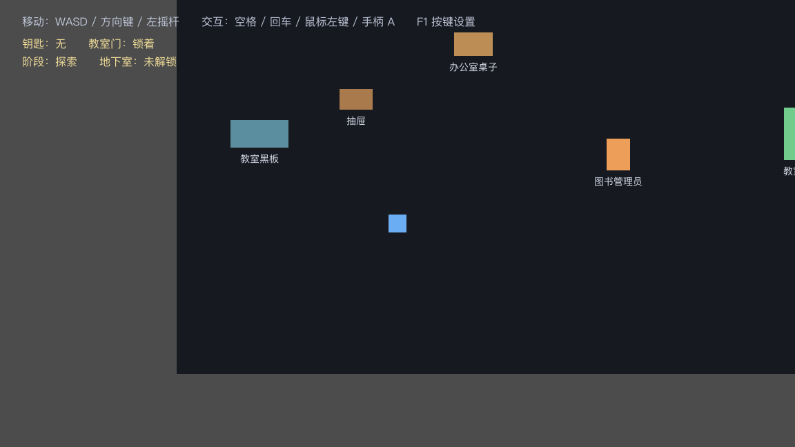 | 初始世界 |
| 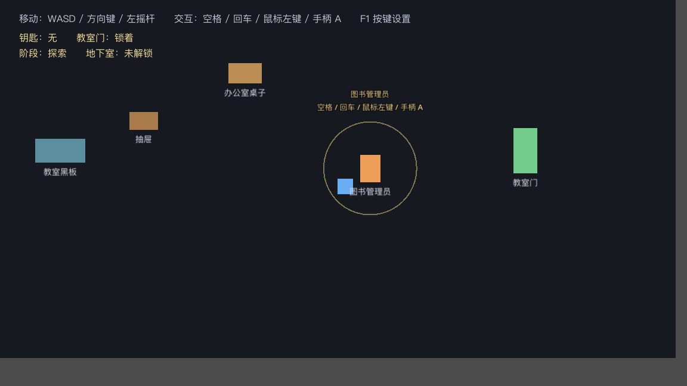 | 交互提示 |
| 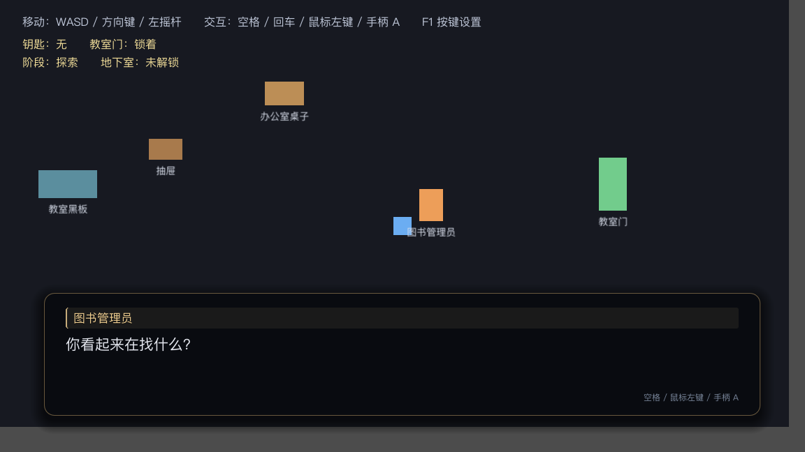 | 短正文（动画结束） |
| 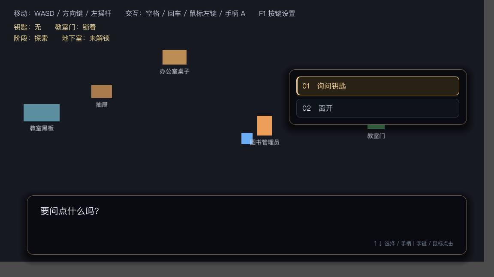 | 选项（修复后：按钮撑满面板） |
| 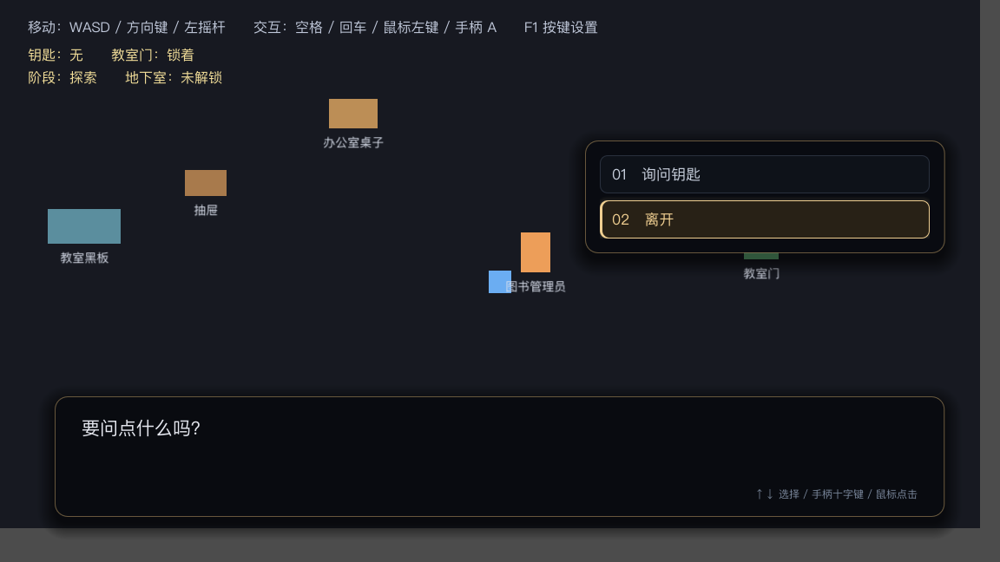 | 方向键切换选中 |
| 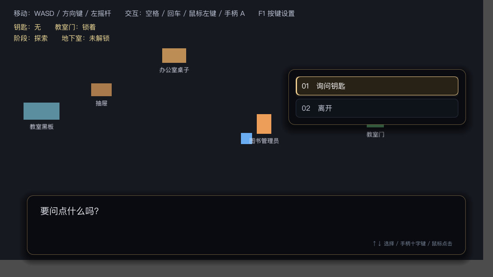 | 鼠标悬停选中 |
| 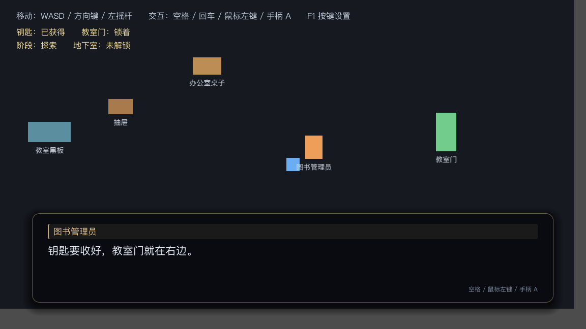 | 条件页最终画面 |
|  | 长文本第 1 页 |
| 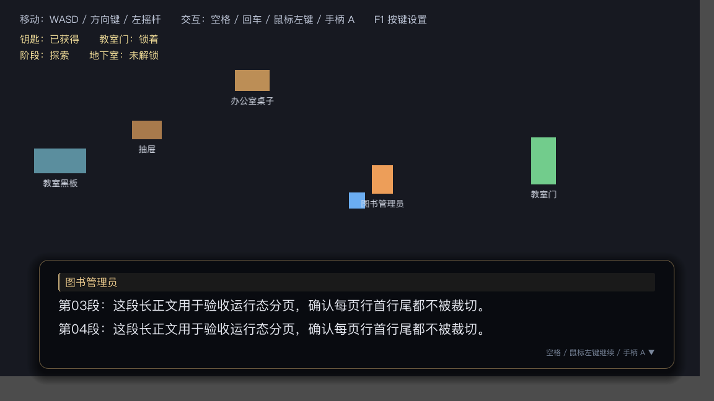 | 长文本第 2 页 |
| 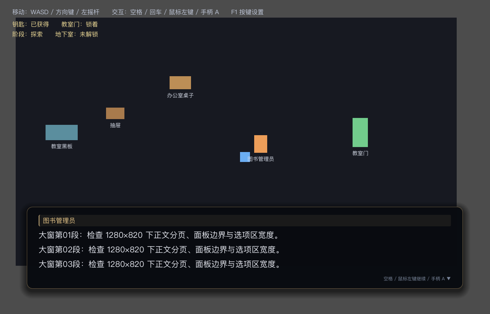 | 1280×820 边界 |
| 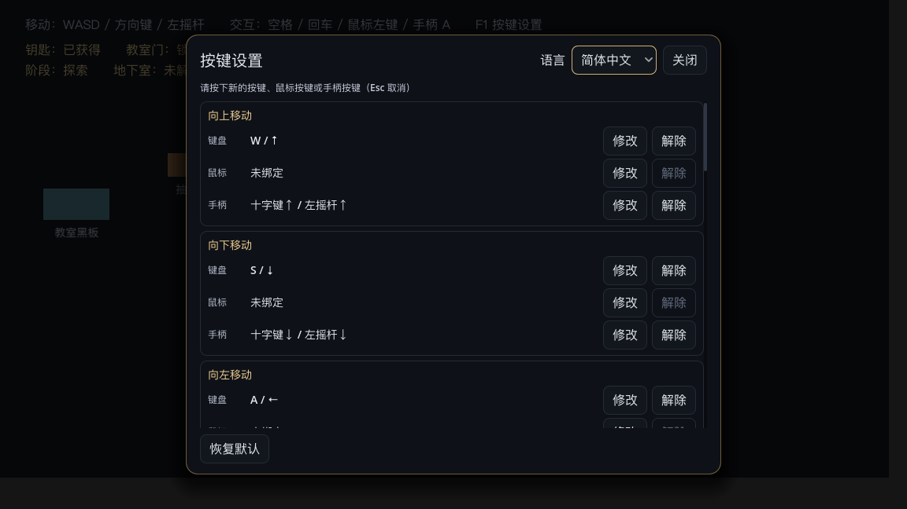 | 按键设置弹层 |
| 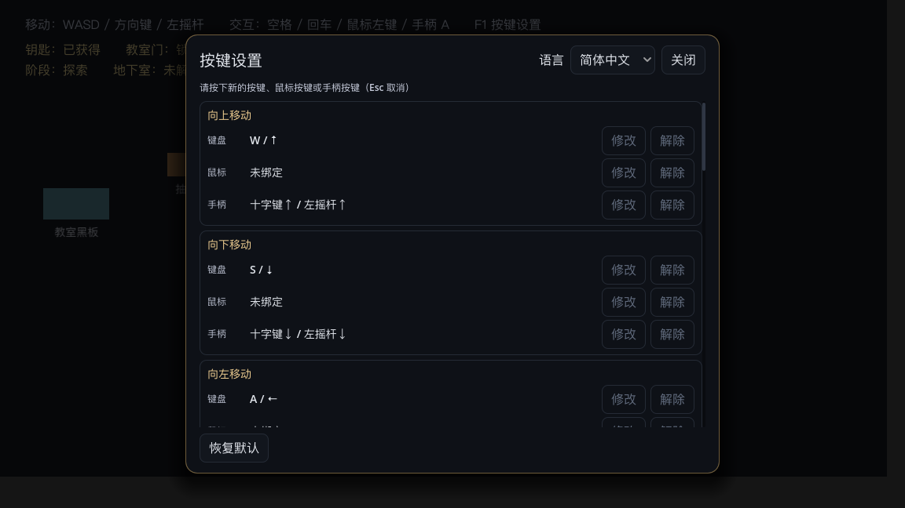 | 改键监听态 |

---

## 四、发现的问题与修复（2 处，均为最小改动）

### 问题 1：选项按钮只按文字宽度排版，缩在面板左侧

- 现象：面板宽 415，按钮只有 96–130 px，右侧大片空白（用户指出「位置很奇怪」）。
- 原因：`ScrollContainer` 只在子节点带 `EXPAND` 时才把它拉到自身宽度；`_choices_box` 没有该标记，VBox 宽度停留在文字最小宽度。
- 修复：`addons/rpgeventstudio/runtime/ui/dialogue_box.gd` — 给 `_choices_box` 设 `SIZE_EXPAND_FILL`（按钮随之撑满）。
- 效果：按钮 380/380（2 选项）、493/501（12 选项含滚动条）。

### 问题 2：运行态长文本页底裁掉半行

- 现象：第 3 行只露出上半截（旧截图 10 号）。
- 原因：正文高度用 `font_size + line_separation`（21+7=28）估算并取整，而 PingFang 实际行高 31+7=38；84 px 的视口只装得下 2.2 行。
- 修复：同一文件 — 取字体真实度量 `font.get_height(size) + line_separation` 取整；窗口矮到放不下 `text_min_height` 时优先保证整行。
- 效果：视口 76 px = 2×38，1280×820 下 114 = 3×38，页底不再露半行。

### 对应回归测试（复用现有两套专项，未新建框架）

| 套件 | 新增断言 | 基线反证 |
|---|---|---|
| `tests/dialogue_layout_test.gd` | 短选项时按钮撑满选项区宽度（380/380） | 基线 96/380 → FAIL |
| `tests/dialogue_pagination_test.gd` | 默认字体正文高度按真实行高取整；页底下一行起点 ≥ 视口 | 基线 84/38=2.21 行、76<84 → 2 项 FAIL |

反证日志：`docs/qa/2026-11-03/ui-appearance-runtime/regression-fails-on-baseline-*.log`。

---

## 五、测试结果（区分「Kimi 的 261」与「本轮新增」）

### 1. Kimi 原有 261 项：保留记录（可复现）

用 Kimi 原版 `dialogue_box.gd` + 原版测试复跑：

- `dialogue_pagination_test`：**245 项，0 失败**
- `dialogue_layout_test`：**16 项，0 失败**
- 合计 **261 项，0 失败**（日志：`kimi-original-*.log`）

### 2. 本轮修复后

- `dialogue_pagination_test`：**282 项，0 失败**（页数变多，逐页检查随之增加 + 2 项新断言）
- `dialogue_layout_test`：**19 项，0 失败**（+3 项新断言）
- 合计 **301 项，0 失败**

### 3. 全量 headless（`tools/test_runner.py --headless`）

- 22 个套件 + import：**1382 项，全部 PASS**（`headless-all.log`，含 `run` 355、`story_insert_choice_test` 55 不变）
- `tools/test_counts.json` 已同步 `dialogue_layout_test=19`、`dialogue_pagination_test=282`

### 4. 运行态

- `ui_runtime_acceptance.gd`：**45 项，0 失败**（`result.json` / `runtime-acceptance.log`）

---

## 六、当前 Git 状态

```
工作树：/Users/elawang/Godot/rpg-studio-ui-appearance-verify
分支：  feat/ui-appearance-runtime-acceptance
基点：  83752e8 (release/0.2.0-rc1)
```

改动文件：

```
M addons/rpgeventstudio/core/theme/dialogue_theme.gd
M addons/rpgeventstudio/editor/event_editor/event_editor_panel.gd
M addons/rpgeventstudio/editor/level_graph/level_graph_view.gd
M addons/rpgeventstudio/editor/story/story_editor_panel.gd
M addons/rpgeventstudio/editor/theme/dialogue_theme_view.gd
M addons/rpgeventstudio/plugin.gd
M addons/rpgeventstudio/runtime/ui/dialogue_box.gd      ← 本轮 2 处修复
M addons/rpgeventstudio/runtime/ui/input_settings_panel.gd
M addons/rpgeventstudio/runtime/ui/state_debug_panel.gd
M addons/rpgeventstudio/runtime/ui/trace_debug_view.gd
M tests/dialogue_layout_test.gd                          ← 回归断言
M tests/dialogue_pagination_test.gd                      ← 回归断言
M tools/test_counts.json
?? addons/rpgeventstudio/core/theme/studio_design.gd (+ .uid)
?? tools/acceptance/  docs/images/ui-appearance-runtime/  docs/qa/2026-11-03/
?? deliverables/rpg-studio-0.2.0-rc2-ui-patch-r2.zip
```

`release/0.2.0-rc1` 基线分支与 Kimi 原目录均未被修改。

---

## 七、尚未解决 / 已知问题（均不影响本轮验收结论）

1. **示例场景背景固定 1152×648**：放大到 1280×820 时四周露出引擎默认底色（见 12b 截图）。属 `school_demo` 样例自身行为，与 UI 拓展包无关；如需全窗口背景应改示例场景，不应在插件里兜底。
2. **说话人条目前是通栏底色**（细香槟金左边线 + 全宽底托）：视觉上像一条通栏输入框，是否收成「标签宽度」需设计确认；本轮未改，避免擅自变更 Kimi 的设计意图。
3. **按键设置面板底部**：滚动区最后一行会被裁在面板底缘，关闭/恢复按钮紧贴其下，没有分隔背景；功能正常，属视觉打磨项。
4. **选项面板按主题锚点定位**，可能压住场景内元素（如「教室门」标签）；这是主题 `choice_top/bottom` 的既有布局契约。
5. **`tools/test_counts.json` 历史不一致**：Kimi 接手时该文件写 `dialogue_pagination_test=190`，实际已是 245（本轮修正为 282）。说明此前有人改测试未同步计数；本轮已同步被改动的两套，其余套件计数一致。
6. **补丁包需在干净安装再验一次**：本轮运行态是在工作树工程上完成的；若要用 `deliverables/rpg-studio-0.2.0-rc2-ui-patch-r2.zip` 发版，建议按原流程在空白工程安装后再跑一次 `ui_smoke`/`run` 与运行态脚本。
